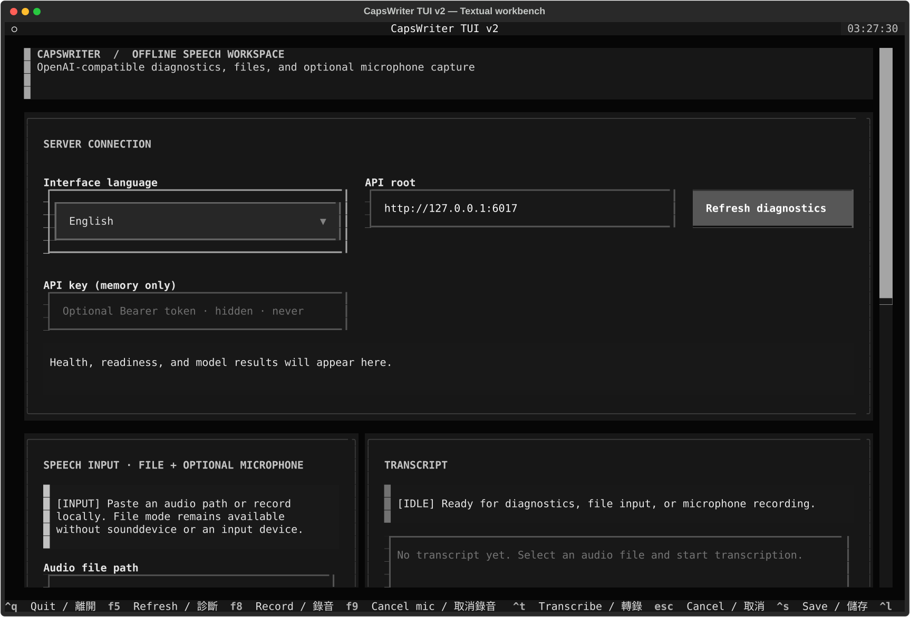

# Getting started

> [Documentation home](README.md) · [繁體中文](../zh-TW/getting-started.md) · [Troubleshooting](troubleshooting.md)

CapsWriter fork v2 always involves two decisions: **where the ASR server runs**
and **which client sends audio to it**. The server loads the model; clients do
not. Read [Server and client roles](server-and-clients.md) before continuing if
that distinction is new.



The screenshot is generated from the real Textual client, not a mockup. The
model and inference worker are still on the server it connects to.

## 1. Pick where the server runs

| Need | Server path | Do not infer |
|---|---|---|
| Full Windows desktop dictation | Windows packaged/native server | Package self-check is not real audio/tray/hardware evidence |
| Linux desktop dictation | Native source server in an X11 session | X11 support does not imply Wayland global-hotkey support |
| Shared/headless ASR | Linux `amd64` container server | `/health` alone does not prove the model is ready |

## 2. Pick a client

| Interaction | Client | Server interface | Important boundary |
|---|---|---|---|
| Tray, global hotkeys, text injection | Desktop client | WebSocket `6016` | Windows native; Linux global hotkeys require X11 |
| Browser recording/upload | Web Console | HTTP `6017` | Browser TTS is local, not server TTS |
| Scripts, SSH, batch jobs | No-GUI CLI | HTTP `6017` | No microphone, tray, hotkey, or text injection |
| Keyboard-first terminal workflow | Textual TUI | HTTP `6017` | File mode is core; native microphone is optional |
| Existing integration | OpenAI SDK/curl | HTTP `6017/v1` | Only the documented transcription subset is implemented |

Web/CLI/TUI/SDK require the opt-in HTTP API. The desktop client uses WebSocket
directly and normally does not require HTTP.

## Common prerequisites

- Git and enough storage for the repository, selected model, and generated
  artifacts.
- Python 3.10–3.12 for the fork's portable client/verification surfaces.
- A supported audio input/output device only when the chosen path uses one.
- ffmpeg on a source/server host when decoding formats that require it.
- Docker Engine + Compose plugin for the container path.
- A logged-in X11 session for Linux desktop global shortcuts.

Clone the fork rather than the upstream remote when following these docs:

```bash
git clone https://github.com/DF-wu/CapsWriter-Offline-Container.git
cd CapsWriter-Offline-Container
```

Do not commit `.env`, API keys, local recordings, model archives, or generated
release directories.

## Path A: Windows desktop

The Windows desktop path keeps the upstream tray, shortcut, recorder, and file
transcription surfaces. The fork's `build.spec` packages the universal server
entrypoint so the optional HTTP API can be enabled without replacing normal
desktop defaults.

1. Read [desktop portability](desktop-portability.md#windows-package-and-http-api).
2. Create a disposable Windows virtual environment and install the client and
   server requirements plus the selected PyInstaller version.
3. Build `build.spec` from the repository root.
4. Validate both packaged executables on a real Windows desktop: launch/exit,
   tray, configured shortcuts, microphone record/stop, file transcription,
   model load, and optional HTTP health/readiness.
5. Record the exact Python, dependency, PyInstaller, Windows, and hardware
   versions with the release artifact.

The automated portability matrix compiles and exercises the portable source
contracts on `windows-2022`; it does not replace step 4.

## Path B: Linux X11 desktop

Linux desktop shortcuts require a real X11 session and the client dependency
stack. Confirm the environment before launching:

```bash
test "${XDG_SESSION_TYPE:-}" = x11
test -n "${DISPLAY:-}"
CAPSWRITER_SERVER_ADDR=127.0.0.1 python start_server_universal.py
```

Launch the desktop client separately from the same logged-in graphical session:

```bash
python start_client.py
```

On X11, keyboard and common side-button callbacks work, but CapsWriter forces
shortcut suppression off because `pynput` cannot safely suppress only one
configured key. Wayland and headless sessions report the unsupported backend
instead of constructing a listener that cannot work reliably.

Read [Linux X11 hotkeys](desktop-portability.md#linux-x11-hotkeys) before
changing shortcut behavior.

## Path C: Linux container server

Prepare local configuration and the hotword mount:

```bash
cp .env.example .env
cp hot-server.example.txt hot-server.txt
docker compose up -d capswriter-server
docker compose ps
docker compose logs -f capswriter-server
```

The first bootstrap downloads models; named volumes persist models and logs.
Deployment now uses only `docker-compose.yml`. Defaults run on CPU without GPU
admission requirements. To use NVIDIA, uncomment its NVIDIA block; for Intel/AMD,
uncomment DRI and set the host render/video GIDs. Leave hardware blocks commented
on CPU-only hosts. P4 users additionally set the P4 opt-in flag.

For host-visible model files, set `CAPSWRITER_MODELS_SOURCE=./models` after
preparing the directory for `appuser` writes. Switching sources does not migrate
data. Settings management uses env switches and its persistent volume; Web uses
`docker compose --profile web up -d`. See the
[single-file guide and migration notes](../compose.md) and
[deployment guide](deployment.md#linux-container-profile) for details.

CPU/Vulkan failure requires a successful full-CPU fallback probe; selected P4
CUDA startup failures refuse startup rather than silently serving on CPU.

## Connect a client

The HTTP API is required by the Web Console, CLI, TUI, and OpenAI SDK. Enable it
explicitly, set a key, recreate the server (the HTTP mapping is already present), and require both endpoints to succeed:

```bash
curl http://127.0.0.1:6017/health
curl http://127.0.0.1:6017/ready
```

Then choose one client:

- [OpenAI-compatible API and SDK](openai-api.md)
- [Web Console](web-console.md)
- [No-GUI CLI](cli-client.md)
- [Textual TUI](tui.md)

Use `/ready`, not only `/health`, before sending audio. Readiness reports model
worker, router, ffmpeg, and active limits without exposing the API key.

## First successful transcription

Use a small known audio file whose expected language/content you can verify.
For the CLI:

```bash
export CAPSWRITER_API_BASE=http://127.0.0.1:6017
export CAPSWRITER_HTTP_API_KEY=replace-with-a-long-random-token
python client/cli/capswriter_cli.py ready
python client/cli/capswriter_cli.py transcribe /path/to/known.wav --format text
```

For long-lived services, prefer a mode-`0600` key file instead of a command-line
token or persistent shell history.

## Validate the checkout

Dependency-light repository gate:

```bash
python scripts/verify_all.py
```

Documentation and cleanup:

```bash
PYTHONDONTWRITEBYTECODE=1 python scripts/check_docs.py
python scripts/clean.py
python scripts/clean.py --check
```

The Windows package build/relocation/import gate runs separately in portability
CI. Hardware, model, display, browser-device, and real desktop behavior remain
separate release evidence. See [verification](../verification.md) and
[support/security](support-security.md).

## Next steps

- Production or LAN operation: [Deployment](deployment.md)
- Platform truth: [Desktop portability](desktop-portability.md)
- Failure diagnosis: [Troubleshooting](troubleshooting.md)
- Security and support boundary: [Support and security](support-security.md)
- Upgrade/current changes: [Release notes](release-notes.md)
