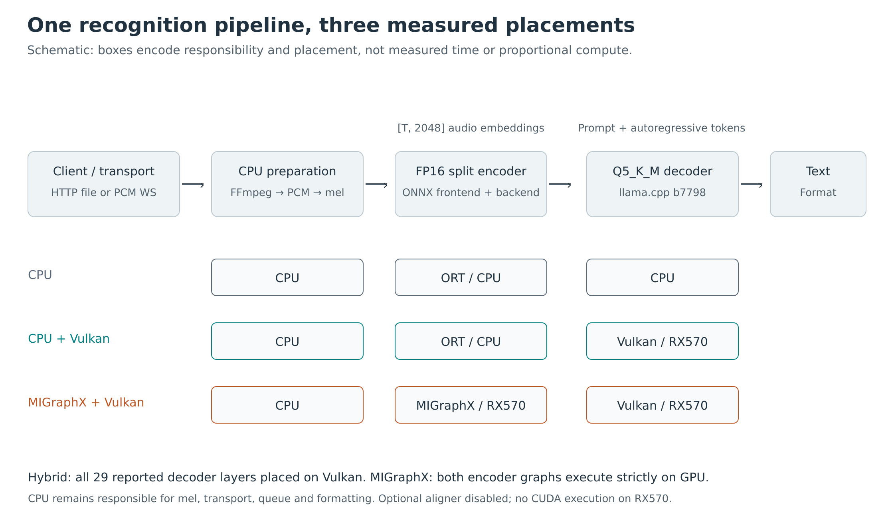
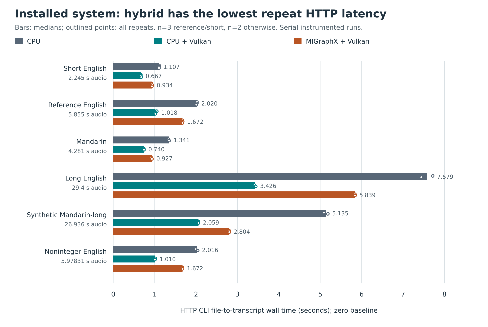
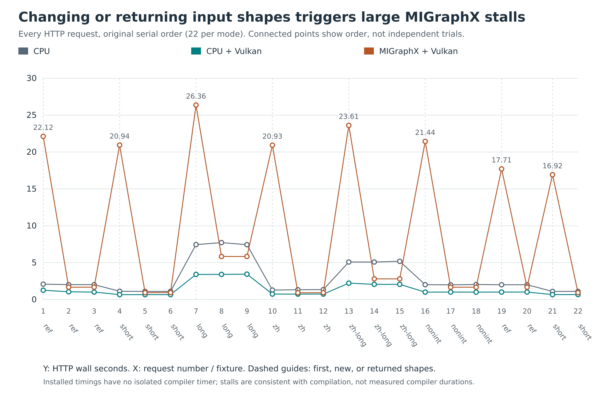
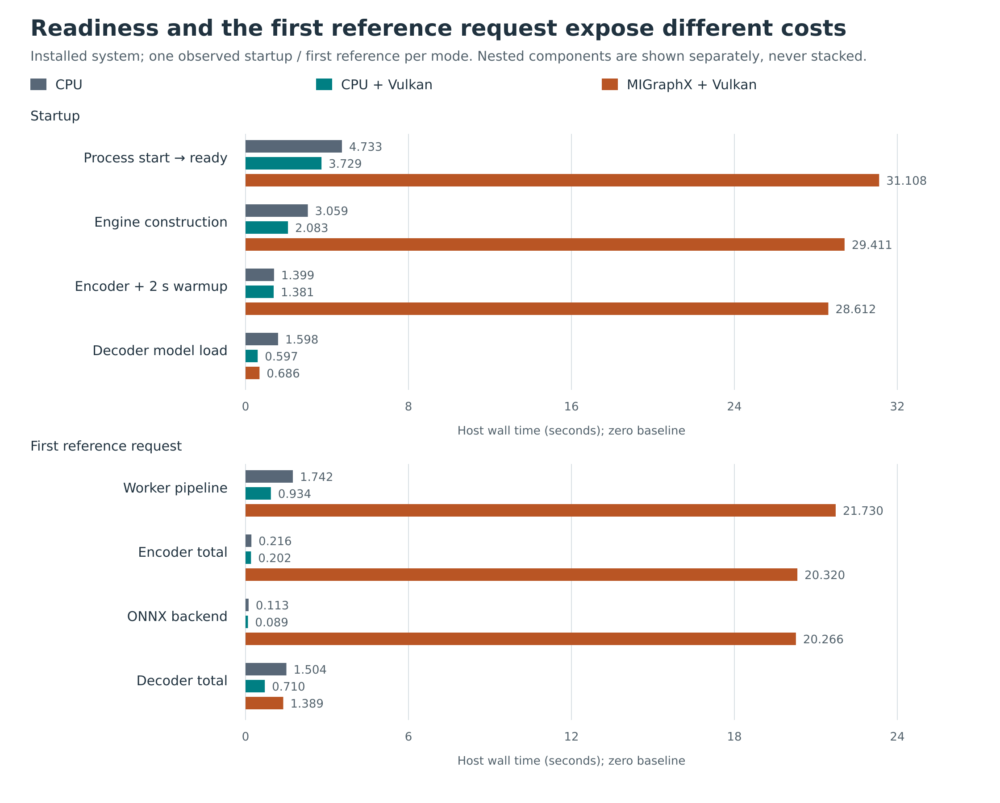
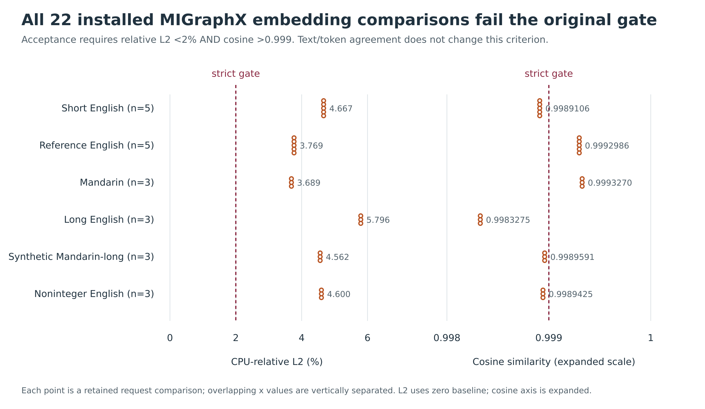
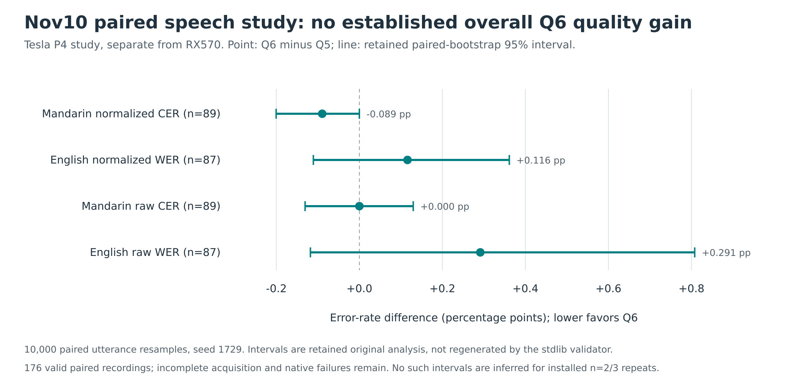

# Qwen3-ASR quantization and RX570 execution: an evidence-based research archive

**Study dates:** 10–15 November 2026 · **Archive date:** 15 November 2026 · **Status:** retrospective technical research; no production deployment.

> [English documentation](../en/README.md) · [繁體中文 reading edition](../zh-TW/rx570-research-20261115.md) · [Evidence, data and regeneration](rx570-20261115/README.md) · [Print-friendly HTML](rx570-20261115/report.html) · [PDF](rx570-20261115/report.pdf)

## Abstract

This report combines a Q5/Q6 decoder investigation, source research into community AMD `gfx803` support, disposable Live-system experiments, and installed-system validation of CapsWriter with Qwen3-ASR-1.7B. These are related studies with different hosts, software states, sampling designs and timing boundaries. They are reported separately. The November 10 experiment retained 874 calls including 14 warmups, 860 measured calls and 176 valid paired primary quality recordings; incomplete planned configurations and native-runtime failures constrain the quantization conclusions. The November 14 work first established actual RX570 Vulkan decoder placement, then executed both original FP16 ONNX encoder graphs through a community MIGraphX runtime and the complete HTTP/WebSocket application. The November 15 installed comparison measured three pairings on a Ryzen 9 3900X, 64 GiB RAM and RX570 8 GiB: CPU encoder/CPU decoder, CPU encoder/Vulkan decoder, and MIGraphX encoder/Vulkan decoder. Each pairing completed the same 22 HTTP requests and one non-paced WebSocket transcription.

For the installed system, CPU encoder plus Vulkan decoder had the lowest repeat HTTP median on every fixture: 0.6673–3.4256 s versus CPU-only 1.1067–7.5794 s and MIGraphX plus Vulkan 0.9266–5.8391 s. MIGraphX executed strictly on GPU in both encoder graphs, with 257 frontend and 24 backend execution events and zero CPU provider execution events. Nevertheless, all 22 embedding comparisons failed the original acceptance condition, relative L2 <2% **and** cosine >0.999. Relative L2 ranged from 3.6889% to 5.7955%. Exact hybrid/MIGraphX text and decoder-token agreement on 22/22 HTTP requests does not waive that failure. First/new-shape HTTP requests took 20.930–26.362 s, and returned reference/short shapes took 17.706/16.921 s. These installed intervals are shape-dependent stalls consistent with compilation; no isolated compiler timer was recorded. The earlier Live logs explicitly recorded compilation events.

Among the three installed pairings tested, the evidence supports the original CPU FP16 encoder plus Q5_K_M Vulkan decoder for variable-duration interactive use. It does not establish broad ASR accuracy, microphone latency, long-term stability, a universal backend ranking, or official ROCm support for RX570. Fixed 60-second padding, buckets and persistent graph-cache alternatives remain untested proposals. This archive contains audited compact observations, source fingerprints, reproducible static figures, an offline validator and detailed historical appendices; private raw logs, audio, model binaries and full profiles are excluded.

## 1. Questions, hypotheses and evidence standard

The investigation addressed six questions:

1. Does a published Q6 decoder improve recognition relative to CapsWriter's Q5 decoder, and is its conversion lineage controlled well enough to attribute a difference to quantization alone?
2. Can RX570 execute the unchanged decoder through Vulkan, and what constitutes evidence of actual layer placement?
3. Can a community `gfx803` userspace execute **both** original ONNX encoder graphs without CPU fallback?
4. Does successful GPU execution also satisfy the numerical criterion and improve complete application latency across changing durations?
5. What is required by the model architecture, what is a CapsWriter adapter choice, and what alternative backends or shape policies are merely proposals?
6. Which results survive transfer from a disposable Live system to the installed host?

The working hypotheses were that higher decoder precision might help quality; Vulkan might accelerate decoder generation; and GPU encoder execution might reduce encoder cost. These were research questions, not prespecified claims of superiority. A positive placement result does not imply numerical acceptance, and a numerical similarity result does not imply transcript accuracy. This report uses four evidence categories: **source observation**, **measured execution**, **derived statistic**, and **untested proposal**. Cause is not assigned where only association was observed.

The source/measurement history and full November 10 results are in [Appendix A](rx570-20261115/source-history.md). The adapter smoke and Live application details are in [Appendix B](rx570-20261115/live-history.md). Installed observations are in [requests.json](rx570-20261115/data/requests.json), [tasks.json](rx570-20261115/data/tasks.json), [numerical.json](rx570-20261115/data/numerical.json) and the [source manifest](rx570-20261115/data/sources.json). Every retained record has a root label, relative filename and line/event/JSON selector. These are the primary anchors for the tables below.

## 2. Architecture, placement and support background

### 2.1 What the model requires

The pipeline converts audio to mel features, obtains audio embeddings from an encoder, assembles them with textual prompt embeddings, and autoregressively generates output tokens. This model needs an audio representation and a language decoder. **It does not inherently require CPU placement for the encoder, Vulkan for the decoder, two ONNX files, or a separate external aligner.** Those are export, integration and backend choices. The tested CapsWriter adapter uses two FP16 ONNX encoder files and a 2048-dimensional embedding interface to a GGUF decoder. Replacing an encoder requires preserving that interface and its learned semantics, not merely matching dimensions. A generic Whisper or SenseVoice encoder cannot be inserted as a drop-in Qwen encoder.

**Figure 1.** Responsibility and placement diagram. Boxes are schematic, not proportional to execution time. “GPU encoder” still leaves mel computation, transport, queueing and formatting on CPU. The optional aligner was disabled; fallback timestamp estimates are not an evaluated alignment result. [Vector version](rx570-20261115/figures/pipeline.svg).

The official Qwen checkpoint configuration declares BF16. The tested split ONNX encoder is a derived FP16 export; those facts should not be collapsed into “the original official FP16 checkpoint.” Q5_K_M describes decoder tensor quantization, not quantization of the ONNX encoder. Likewise, changing an existing Q5 file to Q6 cannot restore information already lost. Publisher metadata alone did not establish a reproducible conversion lineage. Later November 10 binary validation was stronger: all 311 stored tensor payloads in deployed Q5 and publisher Q6 matched their respective direct quantizations of one validated F16 source. Whole-file metadata still differed, and **zero inference calls on those controlled derived files completed**. Appendix A distinguishes this completed tensor validation from the incomplete controlled-file recognition experiment.

### 2.2 CUDA, Vulkan, ROCm and community support

RX570 is AMD Polaris (`gfx803`). CUDA is an NVIDIA backend and was not an RX570 execution route in these tests. The useful cross-vendor decoder route was llama.cpp Vulkan using Mesa RADV. An ONNX Runtime CPU wheel does not acquire MIGraphX support by adding a provider string. The community path needed the actual ORT provider, MIGraphX, patched HIP/HSA/rocBLAS/MIOpen and compiler dependencies. Successful community execution is evidence for this specific stack, not an official AMD support guarantee.

The relevant checked primary sources, exact revisions and source limitations are listed in Appendix A. In particular, ORT's registered/available provider list answers a capability/registration question; execution profiles answer where nodes actually ran. CPU can remain listed in strict MIGraphX sessions while executing zero profiled graph nodes. Conversely, a generic llama.cpp “offloaded 29/29” summary alone proved insufficient in the early smoke investigation: actual individual layer assignments, device identity and buffers were also examined.

### 2.3 Alternative routes and their evidence status

| Route | What changes | Evidence in this investigation |
|---|---|---|
| CPU ONNX + Vulkan GGUF | Decoder placement only | Complete installed comparison; recommended among tested pairings |
| Community MIGraphX ONNX + Vulkan GGUF | Encoder session/provider/userspace | Strict measured execution; numerical failure and dynamic stalls retained |
| Native HIP/ROCm llama.cpp | Decoder backend/build | Source-based candidate; no RX570 head-to-head application result here |
| A complete native Qwen/ggml implementation | Export/runtime integration | Requires matching frontend, encoder, prompt/tokenizer and generation semantics; no installed substitute measured |
| ONNX DirectML | Encoder provider, Windows deployment | Not tested; existing DML-specific padding branch is not evidence of RX570 Linux behavior |
| TensorRT/CUDA | NVIDIA stack | Not an RX570 route |
| Another ASR model/engine | Model and quality behavior | Architectural alternative, not a controlled Qwen backend substitution |
| Fixed shape, duration buckets or compiled-graph cache | Input/compilation policy | Untested; neither accuracy nor latency benefit validated |

“Strict shapes” has two meanings that must stay separate. Strict **provider execution** disables CPU fallback and verifies GPU events. Shape specialization concerns the tensor dimensions for which the compiler builds a program. It does not mean audio must be an integer number of seconds. The tested noninteger fixture has 95,653 samples at 16 kHz, exactly 5.9783125 s. Shape flow and the limitations of a proposed fixed-60-second policy are discussed in Section 9 and Appendix A.

The retained adapter makes the mapping concrete. For `S` input samples, mel length is `T = S // 160`. Frontend inputs are individually padded/chunked to `(1,128,100)`. After concatenation, valid audio length is `N = 13*(T // 100) + ceil((T % 100)/8)`, the equivalent of its three ceiling-by-two reductions on the final partial chunk. Backend hidden sequence length is `N`, its attention mask is `(1,1,N,N)`, and the returned embedding is `(N,2048)`. Observed reference/short/long/Mandarin/synthetic-Mandarin/noninteger lengths were `76/29/382/56/350/78`; prompt lengths were `98/51/404/78/372/100` in these requests. These are audio/prompt positions, not generated text-token counts. A nominal exact 60-second input maps to `T=6000,N=780` by source arithmetic; that is **not** a measured fixed60 implementation. Existing padding/masking only activates in the DirectML branch and does not cap longer inputs. The exact source snapshot/hash and method lines are in Appendix A; all observed shapes remain in `tasks.json`.

## 3. Study chronology and retained failures

| Stage | Purpose and boundary | Outcome and qualification |
|---|---|---|
| Nov 10–11 Q5/Q6 | Source research and a separate retained-data decoder experiment | 860 measured calls; 176 valid paired primary quality recordings. Native failures and 600 missing scheduled calls prevent a completed factorial conclusion; controlled common-source quantization inference count was zero. |
| Nov 14 Live smoke | Direct adapter, no HTTP server; temperature 0 | Actual Vulkan decoder placement and CPU control; encoder still CPU. This was feasibility, not app or microphone latency. |
| Nov 14 Live E2E | Real CLI/HTTP and WebSocket through complete application; effective temperature 0.4 | Both encoder graphs executed on MIGraphX. Immediate warm reference could be slightly faster than hybrid in this Live session, but changed/returned shapes stalled and numerical gates failed. |
| Nov 15 installed baseline | Original CPU and hybrid application on installed host | 22 HTTP +1 WS each; hybrid resumed after harness port preflight failure. Original failure receipt retained. |
| Nov 15 installed diagnostic | Strict MIGraphX encoder-only feasibility and numerical check | GPU execution succeeded; numerical gate failed. App attempt then failed before inference due to an overlong AF_UNIX temporary socket path. |
| Nov 15 installed app continuation | App-only resume using short namespace-private temporary directory | 22 HTTP +1 WS completed; no diagnostic or baseline rerun and no bucket work. Installed conclusions supersede any pending-installed assessment. |

Failure retention matters because a clean successful-path recipe can otherwise hide changes in the question or protocol. The Live work retained snapshot/dependency repairs, failed Wenet audio acquisition/decode attempts, a truncated large image-layer stream, missing MIGraphX dependencies and a frontend convolution layout mismatch. Disabling additional FP16 conversion did not solve that frontend mismatch; channels-first convolution did. The first full GPU application comparison also stopped on the numerical assertion; a subsequent diagnostic E2E explicitly retained the failed criterion while checking transport/text behavior. Appendix B records these attempts separately.

On the installed host, the initial telemetry path could not obtain useful observations while the GPU was suspended. An ordinary task-owned render file descriptor enabled telemetry without changing sysfs power policy. A TIME_WAIT-sensitive port check interrupted the baseline harness; a corrected resume completed hybrid without repeating CPU. The first MIGraphX diagnostic was not discarded when its app launch encountered the AF_UNIX path error. The app-only continuation used a short private temporary directory. Its offline test environment did not mount the isolated test virtualenv; the same dependency-free test passed with system Python. Application inference itself continued to use isolated Python 3.12. These are harness/environment corrections, not evidence that numerical behavior improved.

## 4. Materials, exact software and reproducibility

### 4.1 Hosts and software states

| Item | Nov 14 Live | Nov 15 installed |
|---|---|---|
| CPU / RAM / GPU | Ryzen 9 3900X /64 GiB /RX570 8 GiB | Same nominal hardware |
| Linux | `7.1.8-arch1-3` | `6.18.63-3-lts` |
| Mesa / RADV | `26.1.7` | `26.2.7-1` |
| CapsWriter source | `193882e8b11787bb01eceafbea588d2a4ef3be90` | `a1e2ec3e3f05ca9552f4cdf5822bb701424bf9b7` |
| Python | 3.12.16 for application comparison | 3.12.16 isolated application environments |
| Baseline CPU ORT | 1.23.2 | 1.23.2 |
| Community GPU ORT | 1.29.0+gfx803 | 1.29.0+gfx803 |
| Decoder | llama.cpp b7798 Vulkan /CPU control | Same pinned b7798 decoder libraries |

The community stack retained ROCm 10.1.0 packaging, patched HIP 7.16.26385 (`7da43026e4`), MIGraphX 2.18.0 (`9567291-dirty`) and rocBLAS 5.7.0 (`39d8d60365-dirty`). “Dirty” is part of the recorded community version, not a claim of a clean upstream build. The source project was pinned at Schaka `8fdcf7b1305d0cfc6fc8c1fc7b1bfb5f73494e78`; the image digest and wheel identity are in the artifact table below. Dependency completeness, not provider-name spelling, enabled execution. The useful Live extracted runtime was about 2.6 GiB; the entire task directory was about 7.5 GiB including models, environments, caches and unused partial extraction. The 15.78-GiB compressed builder image was not unpacked wholesale. These are historical acquisition/storage observations, not capacity requirements for every deployment.

### 4.2 Model and runtime artifact identity

| Artifact | SHA-256 |
|---|---|
| Original Qwen3-ASR-1.7B Q5 model ZIP | `f40040fe62a5ef0c09f8699fdbcb30f18bb8ae2bcd515ed4954e1f62b8b0e88f` |
| Q5_K_M decoder GGUF | `89e198470f41d487ab5b6b8a36a35400b3b1534451c4499236983050fe9193e5` |
| FP16 ONNX frontend | `fc288ba9a0ca732251b33628c803cd5188d3dd77a2cd7336f0f0fd37969ed4cd` |
| FP16 ONNX backend | `4b0b1e34e8393f29222006aae0719283b0ff28b61f289b6ff8377b3ddbda27e3` |
| llama b7798 Ubuntu Vulkan archive | `5a4ee2db7e6f9d5c0a04741f79437b433e63862d72a962466b9f28f09f7ffff9` |
| Community ORT cp312 wheel | `b34f7ae304029a17823619b7331d0458c19dac8260ba3cb273ba8258784dd73d` |
| Community final image digest | `60ac8963d7d43899d242973e1a346233f350816971419f423883a46609b116ca` |
| Installed source archive | `886d2d3b11d02647d041c14c0f5b5f5ca7a2f94bcc6b55082a9ebf98e28b8bc6` |

The decoder source revision is `c301172f660a1fe0b42023da990bf7385d69adb4`. The model and decoder download provenance are the original [Q5 archive](https://github.com/HaujetZhao/CapsWriter-Offline/releases/download/models/Qwen3-ASR-1.7B-q5_k.zip) and [llama b7798 Vulkan release](https://github.com/ggml-org/llama.cpp/releases/tag/b7798). Reading upstream release assets is provenance research; this documentation branch targets only the canonical DF-wu fork. Detailed library fingerprints, installed provenance and selected audited configuration facts are indexed in [artifact provenance](rx570-20261115/data/artifacts.json).

### 4.3 Fixtures and reference provenance

All installed modes used the same six fixture hashes, mono 16 kHz audio and independent reference strings. [fixtures.json](rx570-20261115/data/fixtures.json) gives complete hashes, sample counts, download provenance, source revisions and reference text. Audio is not redistributed in this repository.

| Fixture | Samples | Exact duration, s | Construction/reference |
|---|---:|---:|---|
| Reference English | 93,680 | 5.855 | LibriSpeech dummy `1272-128104-0000` |
| Short English | 35,920 | 2.245 | LibriSpeech dummy `1272-128104-0014` |
| Long English | 470,400 | 29.4 | LibriSpeech dummy `1272-128104-0004` |
| Mandarin | 68,496 | 4.281 | Wenet-pinned AISHELL test resource and separate annotation |
| Noninteger English | 95,653 | 5.9783125 | Reference plus exactly 1,973 zero samples |
| Synthetic Mandarin-long | 430,976 | 26.936 | Same Mandarin recording repeated six times with 0.25-second inter-phrase gaps |

LibriSpeech data came from the public dummy parquet at revision `5be91486e11a2d616f4ec5db8d3fd248585ac07a`, source-file SHA-256 `4e69a06fa5edc90921e5e7e39a7084881f8b3ed9c805c574f4f39c6fde27c603`. Mandarin audio and annotation were pinned to Wenet `be6ad97fdb512589df113042f7ff3a29d392fb38`. Repository code licensing is not automatically a license grant for embedded third-party recordings. Fixture attribution, checked license statements and unresolved redistribution questions are in the evidence README and appendices. Hashes and provenance permit reacquisition subject to the respective terms; no recording is included here. Repeated Mandarin is a duration/shape stressor, not six independent utterances or genuine long-form Mandarin evaluation. There was no Taiwan-accent validation.

### 4.4 Effective configuration

Installed application settings were context 2048, batch 4096 (subject to runtime clamping), ubatch 512, eight decoder threads and batch threads, flash-attention/KQV flags enabled, chunk size 80 s, memory count 1, original temperature 0.4 and NumPy seed 1729 per task. Context was empty, original prompt/language mapping remained, aligner was disabled, and DML padding was inactive. The adapter-only smoke used temperature 0, a distinct condition. The HTTP API parsed a temperature field but the unchanged worker did not propagate that value to the adapter; the application comparison therefore used effective adapter temperature 0.4. A request flag must not be reported as an effective setting without tracing the call path.

Strict MIGraphX sessions used `device_id=0`, `migraphx_fp16_enable=0`, `migraphx_exhaustive_tune=0`, ORT optimization `ORT_ENABLE_ALL`, `session.disable_cpu_ep_fallback=1`, Python fallback disabled at construction and disabled again afterward. `MIGRAPHX_GPU_OPTIONS={convolution_layout:channels_first}` resolved the observed frontend layout issue. The community environment also used `HSA_OVERRIDE_GFX_VERSION=8.0.3`, `ROC_ENABLE_PRE_VEGA=1`, visible device 0 and its retained SGEMM shim. No graph weights were rewritten. Disabling an additional FP16 pass preserves the original FP16 graph storage/IO; it does not prove every underlying arithmetic instruction is native FP16. Private namespace mapping of task userspace to a conventional runtime location did not constitute a host-wide ROCm installation.

## 5. Methods and timing boundaries

### 5.1 Protocol and units

Each installed mode ran the same 22-request serial HTTP sequence: first reference plus two repeats; new short plus two repeats; new long plus two repeats; new Mandarin plus two repeats; new synthetic Mandarin-long plus two repeats; new noninteger plus two repeats; returned reference plus one repeat; returned short plus one repeat. A single real WS reference request followed. Reference and short have three `repeat` observations each; the other fixtures have two. First/new/returned requests were excluded from repeat medians by label, not removed from the archive. The complete request sequence appears in Figure 3 and [http.csv](rx570-20261115/data/http.csv).

| Boundary | Starts/ends | Includes / excludes |
|---|---|---|
| HTTP CLI wall | CLI file invocation → returned/consumed transcript | Client startup, file upload, server decode, queue, worker, transport/response consumption; excludes microphone capture |
| WS wall | Sending preloaded PCM chunks → final response | Real protocol with no real-time pacing; excludes initial file reading and natural speech duration |
| Readiness | Application process start → ready response | Imports, worker/engine creation and built-in warmup; not reboot-wide cold cache |
| Engine load | Instrumented engine constructor | Encoder and decoder initialization; nested in readiness |
| Encoder constructor/warmup | Encoder creation including built-in 2-second zero audio | Sessions, warmup and related initialization; not real-audio request latency |
| Worker pipeline | Worker inference processing interval | Encoder, prompt, decoder and surrounding work; nested in transport wall |
| Encoder total | Encoder call | CPU mel + frontend + backend and instrumentation; children are nested |
| Frontend/backend | Individual synchronous ORT calls | Host wall; may contain compile work; not isolated GPU kernel or compiler durations |
| Decoder | Prefill and token generation | `t_prefill`/`t_generate` are source `time.time()` seconds despite stale schema “ms” comments |

Nested columns cannot be summed as independent costs. For example, encoder total includes frontend and backend, and worker pipeline includes encoder and decoder. Unaccounted wall differences are not automatically “network latency.” Profiling, embedding saves, process/file overhead and clocks can contribute. No decomposition experiment isolated those causes.

### 5.2 Derived quantities

For a request with audio duration `d` and CLI wall duration `t`, `RTF = t/d`. RTF below one means file transcription wall time was shorter than the file's audio duration; it does not measure conversational latency. Repeat median is the ordinary median of requests with the same fixture/mode and `phase=repeat`; for two observations it is their arithmetic midpoint. The reported CPU/hybrid speed ratio is `median(CPU)/median(hybrid)`, a ratio of descriptive medians.

For CPU reference embedding `C` and GPU embedding `G`, compared after numerical promotion for the metric, relative L2 is `||G−C||₂ / ||C||₂`, cosine is `(G·C)/(||G||₂||C||₂)`, RMSE is `sqrt(mean((G−C)²))`, and maximum absolute difference is `max(abs(G−C))`. The acceptance test is **relative L2 <0.02 AND cosine >0.999**, with matching shape and finite values also required. These thresholds were not relaxed after observing text parity. November 15 public compact metrics are retained summary observations; the public validator can re-evaluate thresholds and pairing, but cannot regenerate an absent full embedding array. Private-array verification and that limit are explicitly indexed.

Reference error uses Levenshtein edits divided by reference units. Installed English normalization lowercases, strips punctuation and expands `Mr.` to `Mister`; Mandarin removes punctuation and scores characters. Hence 4/68 long-English word edits can coexist with a surface `Mr.`/`Mister` difference. November 10 uses its own retained raw/normalized scoring protocol, including separately reported script normalization; it must not be silently rescored using the installed abbreviation rule. Appendix A explains those denominators and bootstrap methodology.

### 5.3 Statistical scope

The installed repeats are sequential observations within one instrumented process/history, not independent randomized trials. No p-values or confidence intervals are inferred for this phase. Medians and individual points describe these observations only. November 10 had a larger paired design and retained bootstrap intervals; those legitimate historical intervals are preserved with their resampling unit and limitations in Appendix A. They do not become uncertainty bounds for the November 15 study. There is no pooled “overall speedup” across hosts, dates or timing boundaries.

## 6. Installed-system results

### 6.1 Complete HTTP latency

**Figure 2.** Installed CLI/HTTP file-to-transcript wall seconds, zero-based bars and actual repeat points. n=3 for short/reference, n=2 otherwise. This is a descriptive within-run comparison. Full precision values remain in JSON/CSV. [SVG](rx570-20261115/figures/http-repeat.svg).

| Fixture | Repeat n/mode | CPU median s | CPU + Vulkan median s | MIGraphX + Vulkan median s | CPU / hybrid / MIGraphX RTF |
|---|---:|---:|---:|---:|---|
| Short English | 3 | 1.106681 | 0.667261 | 0.934386 | 0.493 /0.297 /0.416 |
| Reference English | 3 | 2.019964 | 1.018014 | 1.671683 | 0.345 /0.174 /0.286 |
| Mandarin | 2 | 1.341224 | 0.739887 | 0.926588 | 0.313 /0.173 /0.216 |
| Long English | 2 | 7.579379 | 3.425627 | 5.839149 | 0.258 /0.117 /0.199 |
| Synthetic Mandarin-long | 2 | 5.135269 | 2.058539 | 2.803602 | 0.191 /0.076 /0.104 |
| Noninteger English | 2 | 2.016176 | 1.009676 | 1.672322 | 0.337 /0.169 /0.280 |

Hybrid was 1.66–2.49 times as fast as CPU-only by these median ratios. It was faster than MIGraphX plus Vulkan for all six installed repeat groups. This finding applies to the tested application configuration, not to every encoder microbenchmark or the earlier Live system.

### 6.2 Request order and shape sensitivity

**Figure 3.** Original request number is the x-axis; complete HTTP seconds is the y-axis. Lines connect order, not independent experimental time samples. First/new/returned shapes remain visible. [SVG](rx570-20261115/figures/http-sequence.svg).

| Shape event | CPU s | Hybrid s | MIGraphX s |
|---|---:|---:|---:|
| Reference, first request | 2.091310 | 1.261757 | 22.124222 |
| Short, new | 1.119826 | 0.667389 | 20.942001 |
| Long, new | 7.448232 | 3.404078 | 26.361737 |
| Mandarin, new | 1.278213 | 0.744909 | 20.930057 |
| Synthetic Mandarin-long, new | 5.090604 | 2.223873 | 23.614151 |
| Noninteger, new | 2.017433 | 1.006530 | 21.442440 |
| Reference, returned | 2.006318 | 1.013243 | 17.706382 |
| Short, returned | 1.100336 | 0.671658 | 16.921448 |

The first reference backend call was 20.266 s; returned reference/short backend calls were 16.081/16.022 s. These localize most of the observed stall to the backend call, but the installed instrumentation did not isolate compiler execution. “Shape-dependent stall consistent with compilation/recompilation” is the supported description. A raw `warm` label in historical data can mean the process is running; it does not establish that the current or returned shape is compiled and cached. No fixed-shape, bucket or persistent-cache mitigation was tested.

### 6.3 Startup, components and transport

**Figure 4.** Single observed startup and first-reference components per mode. Independent rows expose nested timing boundaries; they are intentionally not stacked. [SVG](rx570-20261115/figures/startup-components.svg).

| Startup measurement | CPU s | Hybrid s | MIGraphX s |
|---|---:|---:|---:|
| Process start to readiness | 4.732740 | 3.728906 | 31.107710 |
| Engine construction | 3.059445 | 2.083359 | 29.410796 |
| Encoder construction + built-in warmup | 1.399461 | 1.381371 | 28.612410 |
| Decoder model load | 1.597749 | 0.596523 | 0.686183 |

The exact hybrid values above are checked against retained load records by the offline validator; displayed rounding carries no claim of microsecond measurement accuracy. Cache paths differed across resumed workspaces, and system/shader caches were not flushed. These are process-start observations, not power-on cold starts.

| First reference stage | CPU s | Hybrid s | MIGraphX s |
|---|---:|---:|---:|
| Queue | 0.013 | 0.029 | 0.028 |
| Mel | 0.012 | 0.015 | 0.015 |
| ONNX frontend | 0.090 | 0.097 | 0.038 |
| ONNX backend | 0.113 | 0.089 | 20.266 |
| Encoder total | 0.216 | 0.202 | 20.320 |
| Prompt | 0.002 | 0.002 | 0.001 |
| Decoder total | 1.504 | 0.710 | 1.389 |
| Worker pipeline | 1.742 | 0.934 | 21.730 |

The standalone installed encoder diagnostic took 30.401 s for construction/warmup, 21.268 s for first reference encoding and 0.085377 s on an immediate same-shape repeat. That fast encoder-only repeat is not HTTP latency. The slower full-app MIGraphX decoder observation was not causally isolated; contention, clock, thermal and backend explanations remain hypotheses.

Single non-paced WS reference durations were approximately **1.702 /0.734 /17.204 s** for CPU/hybrid/MIGraphX. The MIGraphX WS request followed a short fixture, and its encoder took 15.956 s. Each mode rejected malformed WS input with close code 1008 and invalid file audio with HTTP 400. Error-path success does not establish long-term protocol reliability. [Transport records](rx570-20261115/data/transport.json) preserve exact times/status selectors.

### 6.4 Placement and numerical acceptance

Hybrid and MIGraphX decoder callback evidence identified RX570 RADV, individual layers and all 29 reported layers on Vulkan, with a Vulkan model buffer of 1193.93 MiB and Vulkan host buffer of 204.02 MiB. The CPU control assigned decoder layers to CPU. The “29” includes the loader's reported layer accounting; it should not be confused with the model config's 28 transformer blocks. GPU activity and buffer allocation corroborate placement, rather than substitute for it.

The installed full-app ORT profiles contain **257 frontend and 24 backend execution events on MIGraphXExecutionProvider, zero on CPUExecutionProvider**. The separate diagnostic had 14/3 events. These are repeated fused-node execution events, not 257/24 unique model layers or native GPU instruction counts. Strict fallback configuration, successful graph calls and actual profile events support encoder placement. CPU mel/protocol work remains.

**Figure 5.** Numerical acceptance is a conjunction. L2 uses a zero baseline; cosine uses an explicitly expanded axis around one. Vertically separated points with equal x values are retained repeated comparisons, not independent audio. [SVG](rx570-20261115/figures/numerical-gate.svg).

| Fixture | HTTP comparisons | Relative L2 % | Cosine | Gate pass |
|---|---:|---:|---:|---:|
| Reference | 5 | 3.768892247 | 0.999298580 | 0/5 |
| Short | 5 | 4.666913241 | 0.998910617 | 0/5 |
| Long | 3 | 5.795516152 | 0.998327543 | 0/3 |
| Mandarin | 3 | 3.688884994 | 0.999327012 | 0/3 |
| Synthetic Mandarin-long | 3 | 4.561610679 | 0.998959136 | 0/3 |
| Noninteger | 3 | 4.599727235 | 0.998942520 | 0/3 |

All arrays compared had matching shape and finite values. Every L2 comparison failed; some cosine comparisons also failed. CPU/hybrid encoder outputs were byte-identical in all 22 pairs according to retained private-array verification. The separate Live same-build CPU control differed much less than GPU, so a CPU ORT version difference did not explain most of the observed GPU discrepancy there. That control does not identify a responsible fused operation. Neither FP16 rounding, SGEMM shim behavior nor a specific kernel has been established as the cause. **The numerical result is failure, independently of successful text/token parity.**

### 6.5 Text, tokens and reference errors

MIGraphX/hybrid returned HTTP text and stable decoder-token sequences matched exactly on 22/22 comparisons. CPU/hybrid matched exactly on 19/22: all three long-English requests used surface `Mr.` versus `Mister` differences, with 89 versus 86 generated IDs. Returned application character/timestamp tokens are distinct from the decoder's stable integer IDs; the archive retains the latter separately in tasks.

| Fixture | Reference error per request, all three modes | Interpretation |
|---|---|---|
| Reference English | 0/17 words | Abbreviation-normalized match |
| Short English | 0/5 words | “By Harry Quilter, M.A.” |
| Long English | 4/68 words =5.88% | Name spelling and “at em” versus “Adam”; surface abbreviation differences normalized |
| Mandarin | 0/12 characters | Public mainland Mandarin recording |
| Noninteger reference | 0/17 words | Same speech with exact appended silence |
| Synthetic Mandarin-long | 12/72 characters =16.67% | One of six repeated phrases omitted in every mode |

The reference sentence is “MISTER QUILTER IS THE APOSTLE OF THE MIDDLE CLASSES AND WE ARE GLAD TO WELCOME HIS GOSPEL”; returned text was “Mr. Quilter is the apostle of the middle classes, and we are glad to welcome his gospel.” Mandarin's independent annotation is `广州市房地产中介协会分析`; returned text adds punctuation. Long-English reference names include `LINNELL'S` and `MISTER BIRKET FOSTER`; output includes “Linell's” and “Birkit Foster.” Exact public reference strings, all returned HTTP texts and complete stable ID arrays are retained in compact data. No reference was injected as prompt/context.

None of the 23 application tasks per mode aborted or hit the 512-token generation limit. This is a bounded test-set observation. Exact output agreement does not show that two encoders are numerically interchangeable on unseen speech, and shared errors do not constitute quality success. Synthetic repetition is particularly unsuitable for broad long-Mandarin accuracy claims.

### 6.6 Resources and host validity

| Sampled metric | CPU | Hybrid | MIGraphX |
|---|---:|---:|---:|
| Maximum GPU temperature, °C | 33 | 51 | 61 |
| Maximum total device VRAM, GiB | 0.005562 | 1.473808 | 2.471188 |
| Minimum available system RAM, GiB | 56.425232 | 57.438950 | 55.362972 |
| Maximum summed task RSS, GiB | 4.908527 | 3.392479 | 6.099 |
| Maximum GPU busy, % | 0 | 100 | 100 |

These extrema come from approximately 0.5-second guard telemetry and can miss instantaneous peaks. Total VRAM is device allocation, not model-only memory; summed RSS can double-count shared pages. The per-mode sample counts and exact extrema source lines are in [resources.json](rx570-20261115/data/resources.json). The observation windows differ with run duration and startup; their extrema are not randomized resource-performance comparisons.

No matching GPU fault/reset/timeout was found in the observed intervals. Informational DRM messages were present; an empty-error-match result does not mean the whole kernel log was empty. Workloads remained within 85°C, 12-GiB available-RAM and 10-GiB free-task-disk gates. Retained cleanup observations show task processes and listeners closed, the ordinary render descriptor closed and existing container inventory unchanged. There was no production deployment. Supplemental RAM screening is outside the core comparison; the packet contains no independently audited certification dataset, and absence of application failure cannot certify all RAM or the host.

## 7. Historical results and why they cannot be pooled

The full November 10 quality, latency, auxiliary conditions, stress observations, thermal exclusions, missing schedule and conversion provenance are preserved in Appendix A and [historical.json](rx570-20261115/data/historical.json). The extractor independently recalculates all 23 retained latency aggregates and primary raw/normalized edit totals from the original records. Retained bootstrap intervals are attributed to the original analysis rather than silently recomputed using a different resampling procedure. The seven native process failures and absent controlled-common-source inference are conclusions about completeness, not successful trials removed for convenience.

**Figure 6.** The historical paired speech study uses its retained confidence intervals, with resampling unit and acquisition limits stated. This separate P4 phase does not supply intervals for the installed RX570 repeats. [SVG](rx570-20261115/figures/q5-q6-quality.svg).

That phase used Tesla P4/CUDA, not RX570. Its valid paired primary set was 89 Mandarin and 87 English recordings. Normalized Mandarin CER was 170/3352 for Q5 versus 167/3352 for Q6, a Q6−Q5 change of −0.089499 percentage points with retained paired-bootstrap 95% interval [−0.200461, 0]. English normalized WER was 69/1725 versus 71/1725, +0.115942 points [−0.110869, +0.361239]. Neither interval establishes an overall quality improvement. The raw scores and script-aware checks remain in Appendix A. Valid short latency medians at 2/5/10 seconds were 0.099419/0.400908/0.757695 s Q5 and 0.122869/0.436775/0.829966 s Q6; matched clip-bootstrap mean penalties were approximately 13.98/41.99/92.19 ms. These are engine-call timings excluding model load, HTTP and file preparation.

Thirty of 246 short/long attempts failed latency gates, mostly overlapping temperature/clock/thermal reasons. Long thermal-valid counts were only Q5 1/1/1 and Q6 2/2/0 for 30/60/79-second bins, so the all-completed long timings do not establish a clean ranking. Maximum observed temperature reached 89°C. The auxiliary auto-language, generic-context, artificial-noise, temperature-0.4 and silence/noise stress subsets had unequal acquisition and remain distinct from primary quality. They showed no supported broad Q6 advantage or hallucination/stability guarantee. The interrupted run left 600 planned measured calls missing, and the restoration window exceeded its target; the cause of the intervening host boot was unknown. None of these historical findings authorizes a fresh host action in this archival task.

The November 14 smoke established a useful Vulkan decoder path but did not test a server, HTTP, microphone or GPU encoder. The subsequent complete Live application measured a different environment. Its repeated reference median was about 0.740 s hybrid versus 0.673 s MIGraphX/Vulkan (n=2), while CPU first reference was 1.812 s with no repeated CPU median. Those historical warm reference results do not override the installed finding that hybrid wins on all six repeat groups.

Live application startup readiness was approximately 2.718/2.824/20.386 s CPU/hybrid/MIGraphX; first reference wall was 1.812/0.781/17.520 s. Standalone encoder repeats were CPU 0.114–0.802 s and GPU 0.052–0.256 s, one measured repeat per fixture. Live profile execution was 70 frontend +9 backend events with zero CPU provider graph events. All five embedding tolerances still failed; Live reference relative L2 was 3.769%, long 5.796%, with a same-build CPU control far closer to baseline CPU than GPU. Exact hybrid/GPU texts and stable IDs on that small fixture set were diagnostic output agreement. Explicit `Model Compile` log events support the Live compilation interpretation. First/switch/return penalties were not eliminated.

The two dates differ in kernel/Mesa, source snapshots, caches, retained runtime histories and measurement overhead. Initial Live CPU/hybrid runs overlapped runtime extraction, and GPU startup overlapped a short control. Installed modes were serial and also had unequal histories. No controlled experiment isolated which difference explains the reversed warm full-application ordering. Appendix B retains complete tables, errors, resource windows and source selectors rather than merging those datasets.

## 8. Discussion and threats to validity

**Construct validity.** HTTP file latency, non-paced WS latency, encoder-only calls, adapter calls and microphone-to-text delay measure different things. Only the former four were observed in their specified phases. A desktop hotkey, capture device, real-time endpointing and foreground text insertion were not tested. The aligner was absent. A successfully returned transcript and GPU placement are narrower than production readiness.

**Internal validity.** The installed comparison is serial and unrandomized, with small within-process repeats and differing cache histories. Instrumentation and embedding writes add overhead. The GPU provider uses a different ORT build from the original CPU provider; the Live same-build CPU control limits one explanation but is not a complete arithmetic attribution. Host wall clocks surround synchronous API calls rather than native kernel/compiler intervals. The original files, resumes and failed attempts remain separate so retries cannot be mistaken for a fresh independent replicate.

**External validity.** Six installed fixtures include two derived variants of existing speech, with one synthetic repeated Mandarin sentence. They are not six independent speech domains, and repetitions within a process are not additional speakers. Public mainland Mandarin and English reading do not validate Taiwanese accents, spontaneous conversational speech, noisy microphone capture, broad multilingual behavior or real long-form Mandarin. The community stack and RX570 specimen are specific; another driver/runtime/card can behave differently.

**Statistical validity.** No confidence interval or p-value was manufactured for the installed n=2/3 groups. No latency percentile is interpreted as a stable tail distribution there. November 10's larger paired quality analysis retains its legitimate intervals and planned/noncompleted denominator accounting, but source lineage and uneven completion still constrain attribution. Combining convenient points across dates would obscure these threats.

**Numerical validity.** Text is a many-to-one downstream observation. A decoder can yield equal text despite changed embeddings, especially on a small easy set; that does not establish tolerance compliance. Stable repeat embeddings show repeatability, not accuracy relative to CPU. Matching output shapes and finite values are necessary checks but insufficient for numerical equivalence. The cause of the relative L2 mismatch remains unisolated.

**Evidence and archival validity.** Public compact extracts omit raw arrays and full profiles by design. Source hashes identify the private raw inputs, but a hash is not public availability. The validator distinguishes recomputed public statistics, locally rechecked private-source extractions and retained parent-verified array claims. Missing or unretained data are named; none are reconstructed from a screenshot or invented citation. The compilation packet itself was private and was never treated as a publication-approved log bundle.

## 9. Recommendation and untested future work

For variable-duration use on the installed host, choose the original FP16 CPU encoder with Q5_K_M llama.cpp Vulkan decoder **among the tested pairings**. It preserves the baseline encoder behavior, had the lowest installed repeat HTTP median in every group, and avoided the large GPU-encoder shape stalls. CPU-only remains the measured fallback/control. MIGraphX is a technically successful GPU feasibility result but fails the unchanged numerical criterion and performs worse for this installed dynamic application. No runtime setting or production service was changed by this archive.

The following are research proposals, not validated mitigations:

1. **Complete controlled-file inference.** Retain the already demonstrated common-F16 tensor equivalence, pin quantizer and command, and complete the recognition matrix on the independently generated Q5/Q6 files, with tensor/tokenizer/prompt compatibility checked. Do not up-convert Q5 as a supposed accuracy improvement. Repeat a paired human-speech evaluation with planned configurations actually completed.
2. **Numerical localization.** Compare intermediate outputs under strict provider execution, with same-build CPU controls and documented arithmetic settings, before changing acceptance thresholds. This could identify a discrepancy; the existing evidence does not identify its cause.
3. **Fixed 60-second policy.** Define whether padding happens to PCM, mel frames, encoder chunks or backend embedding inputs. These are not interchangeable. Trimming generated embeddings by an assumed ratio without tracing valid lengths can change semantics. A fixed input can also increase compute, memory and attention/context use; padding with silence does not guarantee unchanged transcription. The current 80-second chunk configuration and context 2048 do not by themselves validate a 60-second implementation.
4. **Duration buckets.** A small set of shapes may reduce specialization churn but needs explicit valid-length/mask behavior, shape-to-prompt mapping, cache eviction/memory accounting and first/switch/return measurements. New bucket work was barred after the failed numerical gate; none ran.
5. **Persistent compiled programs or a different encoder runtime.** A cache must key on graph, shape, dtype, provider/compiler/device and options and survive validation of its outputs. Native Qwen/ggml or another ONNX backend needs complete semantic integration, not only successful model loading. None was benchmarked here.
6. **A stronger application study.** Randomize mode blocks where feasible, control/cache-label histories, include independent natural Mandarin and Taiwanese-accent speech with lawful provenance, evaluate errors before speed, and separately measure paced WS/microphone endpointing and extended stability. These are future requirements, not claims about this fixture set.

## 10. References and reproducibility appendices

Primary references actually inspected, pinned revisions, retrieval dates, publisher-vs-local hash distinctions and community support boundaries are recorded in [Appendix A: sources and quantization](rx570-20261115/source-history.md). The [Live audit](rx570-20261115/live-history.md) supplies the original compilation/configuration sources and acquisition process. Compact artifact identities and source fingerprints are in [artifacts.json](rx570-20261115/data/artifacts.json) and [sources.json](rx570-20261115/data/sources.json); historical raw input fingerprints are in [historical.json](rx570-20261115/data/historical.json).

Read the [archive guide](rx570-20261115/README.md) for the evidence coverage matrix, exact offline commands, public/private retention boundary, audio attribution, generator dependencies and validation limits. The self-contained HTML uses embedded figures and fonts, no live resources or scripts; the PDF is a print artifact from that HTML. Markdown and compact JSON/CSV remain the primary reviewable scientific record.
