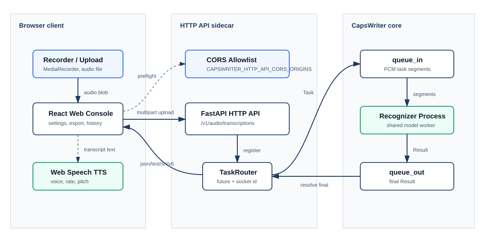

# 部署指南

> [文件首頁](README.md) · [English](../en/deployment.md) · [疑難排解](troubleshooting.md)

本指南分開說明 desktop-local、Linux container、Web Console 與 remote client
profiles。請選擇足以滿足需求、但 network surface 最小的方案。



文字等價說明：browser 先載入 static Web Console 與 runtime configuration，再
直接呼叫 CapsWriter HTTP API 執行診斷與轉錄。Web container 不會代理 audio 到
server，因此 CORS、authentication、publish address、HTTPS 都屬於 browser → API
boundary。

## Deployment profiles

| Profile | Server process | Client | Network 建議 |
|---|---|---|---|
| Windows desktop-local | `start_server_universal.py` 或 packaged server | Packaged／upstream desktop client | 除非另一個本機 user 需要，否則 WebSocket 與選用 HTTP API 都留在 loopback |
| Linux X11 desktop-local | `start_server_universal.py` | Source desktop client | 只限 X11 session；service 留在 loopback |
| Linux container（`linux/amd64`） | `docker-compose.yml` | Desktop、CLI、TUI、SDK | 預設 loopback publish；remote 時使用 key 與 trusted network／TLS |
| Server + Web Console | `docker-compose.yml` + `web` profile | Modern browser | Browser 必須直接到達 API；設定 exact CORS origins 與 secure-context 麥克風 |
| Headless automation | Source／container server | CLI 或 SDK | 優先使用 key file、bounded timeout、readiness check 與 service supervisor |

## Linux container profile

Published server image、locked native Python wheel、CUDA base 與下載的 llama
runtime 都針對 `linux/amd64`。ARM64 沒有 release gate，目前不屬於受支援的
server-image architecture。

建立 deployment-local files：

```bash
cp .env.example .env
cp hot-server.example.txt hot-server.txt
```

使用 configured image，或明確 build 目前 checkout：

```bash
docker build -f docker/server/Dockerfile -t capswriter-server:local .
CAPSWRITER_SERVER_IMAGE=capswriter-server:local \
  docker compose up -d capswriter-server
```

未設定 `CAPSWRITER_SERVER_IMAGE` 時，Compose 會使用 `docker-compose.yml` 內的
image reference。受控 production rollout 應 pin immutable image digest，不依賴
moving channel tag。

核心設定：

```dotenv
CAPSWRITER_MODEL_TYPE=qwen_asr
CAPSWRITER_INFERENCE_HARDWARE=auto
CAPSWRITER_BACKEND_PROBE_TIMEOUT=300
CAPSWRITER_SERVER_PUBLISH_HOST=127.0.0.1
CAPSWRITER_SERVER_PORT=6016
CAPSWRITER_SERVER_MAX_WEBSOCKET_CONNECTIONS=8
CAPSWRITER_SERVER_MAX_WEBSOCKET_TASK_SECONDS=3600
```

現在只使用**一份 `docker-compose.yml`**。預設不要求 GPU，CPU-only host 可直接
啟動。NVIDIA 取消同檔 **NVIDIA** 區塊註解；Intel／AMD 取消 **DRI** 區塊註解，
其他硬體區塊保持註解。Docker 在 entrypoint 前檢查裝置，缺少 host device／runtime
不能靠應用程式 CPU fallback 修復。見[單檔操作及遷移](../compose.md)。

NVIDIA reservation 的 `CAPSWRITER_GPU_DEVICE_COUNT` 可填 all 或正整數。
Tesla P4 再加 `CAPSWRITER_TESLA_P4_OPTIMIZATION=true`；flag 本身不授予 GPU 存取。
DRI 先查 host 實際 GID：

```bash
stat -c '%n %g' /dev/dri/renderD* /dev/dri/card*
# 將 CAPSWRITER_DRI_RENDER_GID／CAPSWRITER_DRI_VIDEO_GID 寫入 .env。
docker compose config --quiet
docker compose up -d --force-recreate capswriter-server
```

Image 有 Mesa Vulkan ICD，host driver、device nodes、group access 仍須具備。
原 CPU／Vulkan 路徑失敗需通過完整 CPU fallback probe；選定 P4 CUDA 後失敗直接
拒絕啟動。每次 probe timeout 為 `CAPSWRITER_BACKEND_PROBE_TIMEOUT`，預設300、>0..1800秒。

### Qwen prefill 與音訊長度

Batch／micro-batch／context 對速度、顯存及辨識結果的影響見
[Qwen 調校指南](../qwen-tuning.md)。目前 Server 一次送完整 prefill，`N_BATCH`
太小可能使長輸入中止；`CHUNK_SIZE=80` 超過會截斷，不是自動切段。其他 ubatch／
context 組合列為試驗值，沒有冒稱新的 P4 實測加速結果。

### Model persistence 與 bootstrap lock

Base Compose 把 `/app/models` 放在 `capswriter-server-models` named volume。Recreate
container 會保留它，且 Docker 會處理初始 ownership；`docker compose down -v` 則會
刻意刪除 named volumes 與已下載 asset。

若需要 host-visible model files，先準備權限，再在 `.env` 設定
`CAPSWRITER_MODELS_SOURCE=./models`：

```bash
image="$(docker compose config --images | sed -n '1p')"
uid="$(docker run --rm --entrypoint id "$image" -u appuser)"
gid="$(docker run --rm --entrypoint id "$image" -g appuser)"
mkdir -p models
sudo chown -R "$uid:$gid" models
CAPSWRITER_MODELS_SOURCE=./models docker compose up -d capswriter-server
```

Bind directory 在 bootstrap 期間必須允許 `appuser` 建立 lock、download、staging 與
ready-marker files。多個 container 共用 storage 時，bootstrap 以
`/app/models/.capswriter-bootstrap.lock` 的 POSIX `flock(2)` 序列化，等待上限由
`CAPSWRITER_MODEL_BOOTSTRAP_LOCK_TIMEOUT` 控制（預設 1800 秒，合法值 > 0 且 <=
86400）。共享 filesystem／volume driver 必須在所有 client 間提供 coherent
advisory locking；未驗證前不要用 NFS／SMB 共用 bootstrap directory。取得 lock
後會重查 readiness。若 model 與 runtime 已完全 ready 且未要求 archive cleanup，
warm path 不建立 lock，也不寫入 model root；任何 repair／download／cleanup 仍需
可寫 storage。

Warm readiness 依內容判定，不只檢查檔案是否存在。Schema 2
`.capswriter-model-ready.json` 會把選定 archive identity／SHA-256 綁定到每個必要
model artifact 的 size／SHA-256 manifest；schema 2
`.capswriter-llama-ready.json` 也會綁定 CPU／Vulkan runtime archive，並記錄各
inference directory 內每個 `.so` 的 size／SHA-256。Startup 會重新 hash 並要求
marker 完全相符，因此同尺寸 corruption、過期 backend marker、缺少 runtime marker
或 library 內容改變都會使 readiness 失效，轉入受 lock 保護的 repair／bootstrap。

### 啟用 HTTP API

API 只有明確 opt in 才會開啟：

```dotenv
CAPSWRITER_HTTP_API_ENABLE=true
CAPSWRITER_HTTP_API_BIND=0.0.0.0
CAPSWRITER_HTTP_API_PUBLISH_HOST=127.0.0.1
CAPSWRITER_HTTP_API_PORT=6017
CAPSWRITER_HTTP_API_KEY_FILE=/run/secrets/capswriter-http.key
CAPSWRITER_HTTP_API_CORS_ORIGINS=
```

Key-file path 必須存在於 container 內；請在同檔加入 read-only
secret mount。若同時設定，explicit `CAPSWRITER_HTTP_API_KEY` 優先。

HTTP mapping 已在同檔提供，API 關閉時 Docker 仍保留6017；啟用 API 與 key 後 recreate。除非 remote client 確實需要 direct access，否則保留
`CAPSWRITER_HTTP_API_PUBLISH_HOST=127.0.0.1`。

API 在 container 內 bind `0.0.0.0`，只要 published host address 仍是
`127.0.0.1`，host 端就仍限 loopback。兩者是不同 network boundary。

### Readiness 與維運

```bash
docker compose ps
docker compose logs --tail=200 capswriter-server
curl http://127.0.0.1:6017/health
curl http://127.0.0.1:6017/ready
```

- `/health` 證明 HTTP process 有回應。
- `/ready` 檢查 router／model worker／ffmpeg readiness，並回報 configured
  operational limits。只有 ready 才應導入 production traffic。
- Compose health 也會檢查 WebSocket；HTTP 啟用時還要求 HTTP readiness。

第一次啟動可能在 health-check start period 內下載 model 與 runtime library。先
看 log，不要直接判定 crash。

## Windows 與 source-server profile

Desktop source 與 Windows package path 使用
[`start_server_universal.py`](../../start_server_universal.py)。HTTP API 關閉時，
它保留一般 upstream server behavior；啟用時只套用已驗證的
`CAPSWRITER_HTTP_API_*` values。

PowerShell loopback 範例：

```powershell
$env:CAPSWRITER_HTTP_API_ENABLE = "true"
$env:CAPSWRITER_SERVER_ADDR = "127.0.0.1"
$env:CAPSWRITER_HTTP_API_BIND = "127.0.0.1"
$env:CAPSWRITER_HTTP_API_PORT = "6017"
$env:CAPSWRITER_HTTP_API_KEY = "replace-with-a-long-random-token"
python .\start_server_universal.py
```

上游 desktop WebSocket 預設為 `0.0.0.0`；整個範例只有在明確設定
`CAPSWRITER_SERVER_ADDR` 後才是 loopback-only。省略它會為了相容性保留上游行為。

Packaged release 必須透過 packaged server executable 重做驗證；source run 無法
證明 hidden import 或 bundled native library。詳見[桌面可攜性](desktop-portability.md)。

## Web Console profile

以同檔 web profile 啟動公開 Web image。若需本機 build，先在 `.env` 保存
`CAPSWRITER_WEB_IMAGE=capswriter-web:local`，執行
`docker compose --profile web build capswriter-web`，再用相同 up 命令：

```bash
CAPSWRITER_WEB_API_BASE=http://127.0.0.1:6017 \
  docker compose --profile web up -d capswriter-web
curl http://127.0.0.1:8080/health
curl http://127.0.0.1:8080/config.js
```

Web publish address 預設是 loopback。Remote browser 需要：

1. 把 Web service 發布到明確 interface 或 reverse proxy；
2. 將 `CAPSWRITER_WEB_API_BASE` 設為 browser 可到達的 API URL，不只是 Web
   container 可到達；
3. 把 exact Web origin 加入 `CAPSWRITER_HTTP_API_CORS_ORIGINS`；
4. 非 loopback 麥克風使用 HTTPS；
5. 對 API 做 authentication。

除非所有可載入 `/config.js` 的人都可讀取 shared secret，否則不要透過
`CAPSWRITER_WEB_API_KEY` 注入。Container 會要求同時設定
`CAPSWRITER_WEB_ALLOW_PUBLIC_API_KEY=true`；改在 browser UI 輸入 token，會讓它
只留在 page memory。

詳見 [Web Console Client 指南](web-console.md)。

## Persistence 與 backup

| State | Location | Backup guidance |
|---|---|---|
| Model 與 archive cache | `capswriter-server-models` named volume；選用 `CAPSWRITER_MODELS_SOURCE=./models` bind source | 只有 download cost／availability 值得時才備份；複製 asset 時保留 provenance 與 checksum |
| Downloaded llama runtime | Container writable layer | Recreate 時由 verified bootstrap 重建；不當成 persistent backup |
| Server hotword | Read-only `./hot-server.txt` bind | 視為 configuration 備份；移到不同 model type 前先 review |
| Server log | `capswriter-server-logs` named volume | 依 privacy／operations policy 留存；transcript logging 預設關閉 |
| `.env` 與唯一 Compose 檔 | 只留 deployment host | 安全備份；不可 commit key 或 local path |
| Web history／settings | Browser localStorage | 最近的 transcript／raw history 是可能敏感的明文；per-browser、best effort，並非 server backup 或 encrypted-record system |
| TUI／CLI transcript output | User-selected filesystem path | 視同一般 user document 備份 |

Compose 預設只把既有的 `./hot-server.txt` file read-only bind-mount，且拒絕自動
建立缺少的 source path；model 與 log 各用 named volume。
刪除 container 不會刪除 named volume 或 host hotword，但 `docker compose down -v`
會刪除 named volumes。設定 `CAPSWRITER_MODELS_SOURCE=./models` 後，`./models` 才是
operator-managed host state。

## Remote access 與 TLS

CapsWriter 本身不終止 public TLS。Traffic 離開 trusted host 時，請在 API 前放置
maintained reverse proxy 或 private overlay network，保留 request-size／timeout
limits，並 forward Authorization header。TLS 存在也不能當成關閉 authentication
的理由。

只有真正需要時才發布 WebSocket 與 HTTP endpoint。使用 explicit CORS allowlist；
CORS 是 browser control，不是 non-browser client authentication。

## Upgrade 與 rollback

1. 讀 [release notes](release-notes.md)與[版本政策](versioning.md)。
2. 備份 `.env`、hotword、唯一 Compose 檔，以及無法重新取得的 model asset／log。
3. Pin candidate source commit 或 image digest。
4. 跑 repository／image gate，以及 known-audio readiness／transcription test。
5. Recreate 一個 instance，驗證 `/health`、`/ready`、`/v1/models` 與所需
   response formats。
6. 分批移動 client；rollback window 內保留 previous image digest／source
   checkout 與 configuration。

Rollback 應恢復 previous immutable source／image 與 compatible configuration。
不要對 dirty deployment checkout 執行 `git reset --hard`，也不可 merge 隔離的
v1／v2 product generation。

## Production checklist

- [ ] 已選正確 platform/profile；沒有假設 unsupported Wayland hotkey。
- [ ] 已記錄 immutable source 或 image reference。
- [ ] API 不用時關閉；啟用時有 authentication 且 publish 最小化。
- [ ] Restart 後 `/health`、`/ready` 都通過。
- [ ] Startup log 顯示 configured backend probe 通過，或 mandatory CPU fallback probe 通過。
- [ ] Known audio 以所需 model／format 成功。
- [ ] CORS 只包含 deliberate browser origins。
- [ ] 沒有意外公開 default Web key。
- [ ] Model、hotword、configuration、log、output 有明確 retention policy。
- [ ] 已記錄 rollback reference 與 operator steps。

Status code 與具體症狀請接著讀[疑難排解](troubleshooting.md)。
