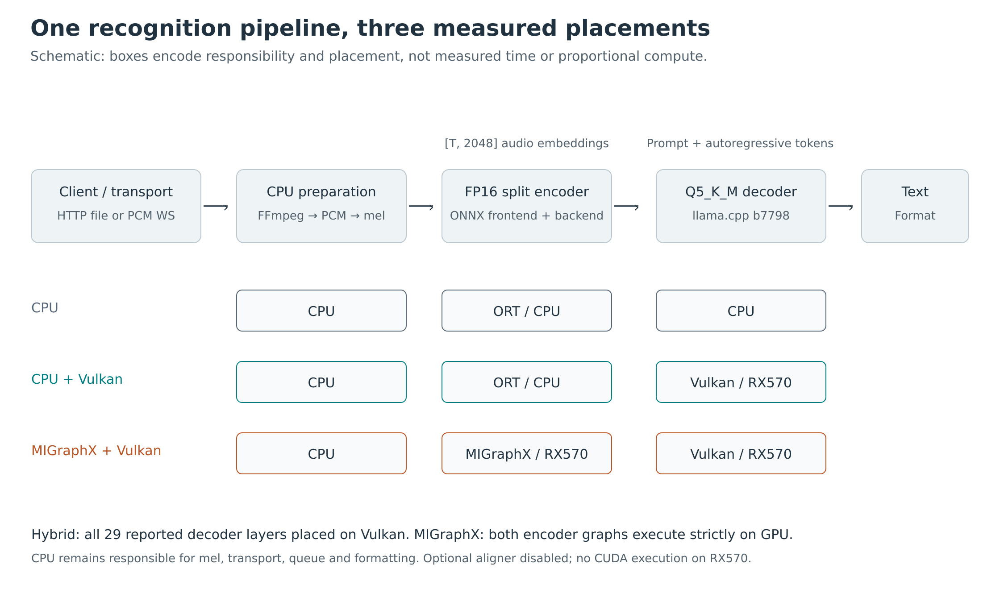
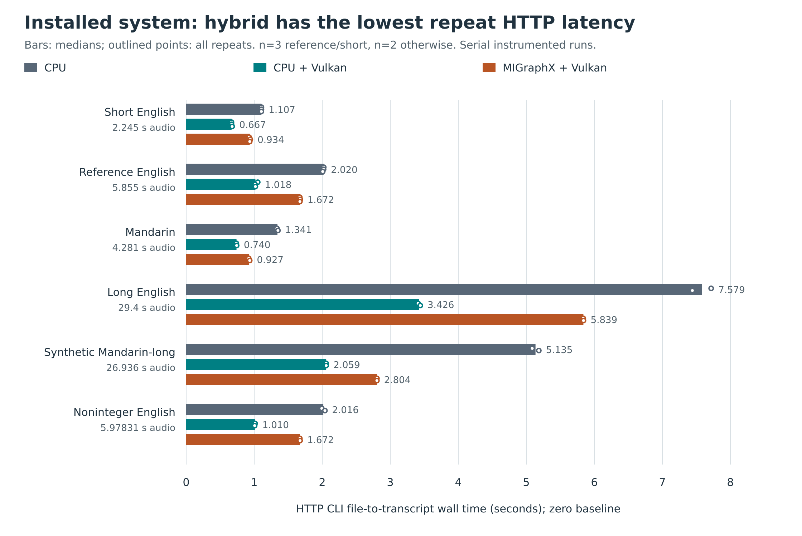
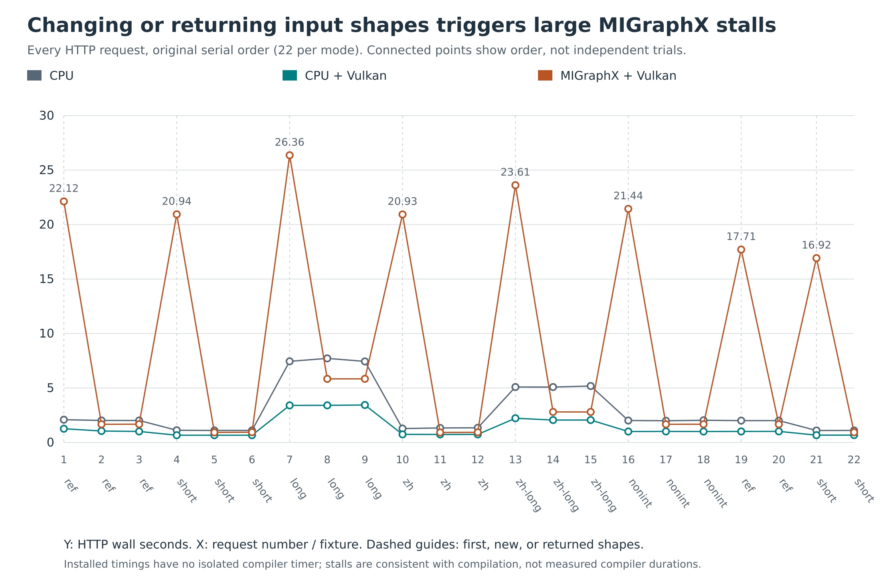
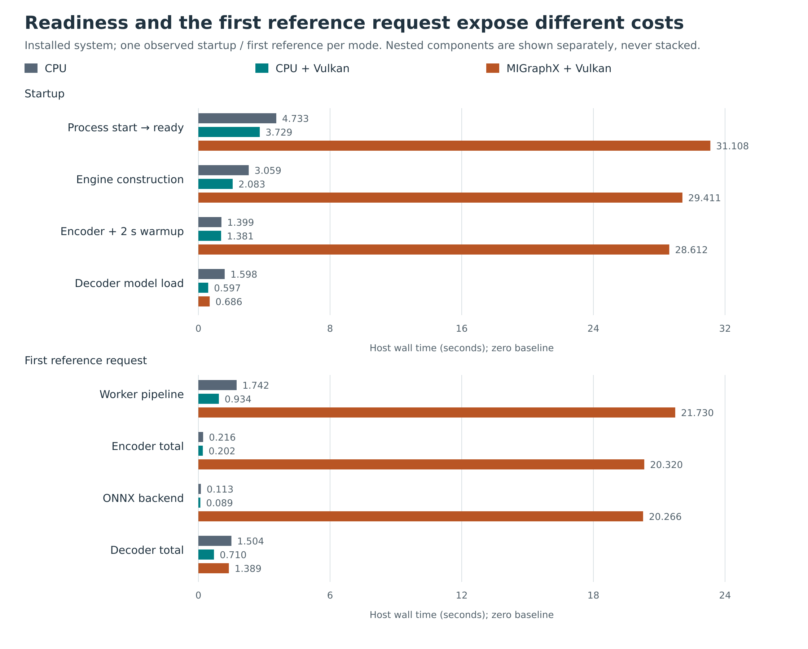
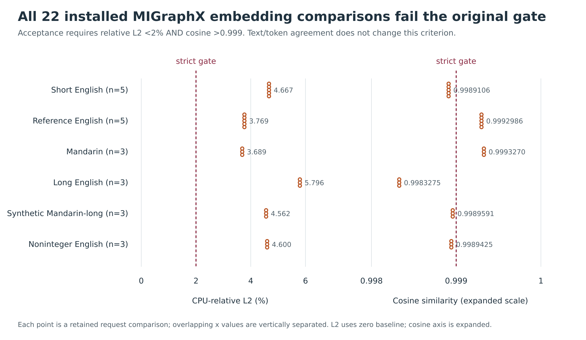
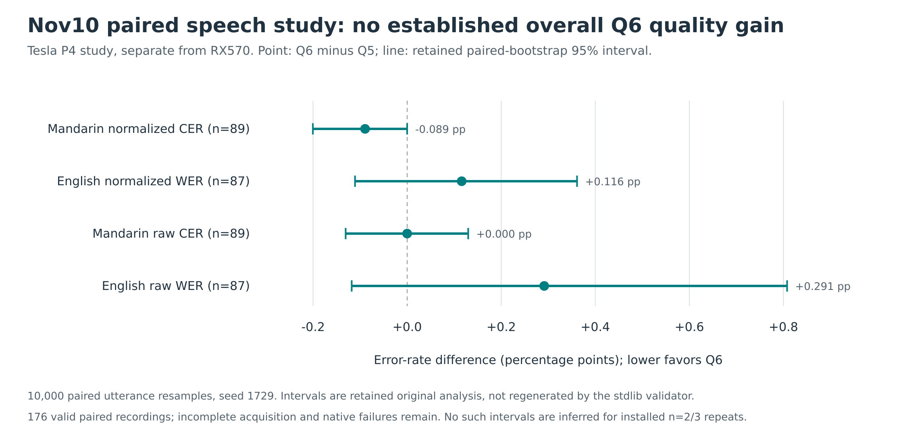

# Qwen3-ASR 量化與 RX570 執行：以證據為本的研究封存

**研究日期：**2026 年 11 月 10–15 日 · **封存日期：**2026 年 11 月 15 日 · **狀態：**回溯性技術研究，未部署至正式環境。

> [English research report](../reports/rx570-qwen3-asr-research-20261115.md) · [繁體中文文件](README.md) · [證據、資料與重新產生方式](../reports/rx570-20261115/README.md) · [適合列印的英文 HTML](../reports/rx570-20261115/report.html) · [英文 PDF](../reports/rx570-20261115/report.pdf)

本頁是主報告的完整繁體中文閱讀版，末尾另附歷史研究導讀。圖表沿用同一批可重現的靜態圖；完整英文附錄保存逐項附表、來源選取位置與指紋。

## 摘要

本報告整合 Q5／Q6 解碼器研究、社群 AMD `gfx803` 支援的原始來源查核、一次性 Live 系統實驗，以及已安裝系統上 CapsWriter 搭配 Qwen3-ASR-1.7B 的驗證。這些研究彼此相關，但主機狀態、軟體、取樣設計與計時邊界不同，因此分開呈現。11 月 10 日實驗保留 874 次呼叫，包含 14 次暖機、860 次測量，以及 176 段有效配對的主要品質錄音；未完成的預定配置及原生執行期失敗限制了量化結論。11 月 14 日先確認 RX570 確實以 Vulkan 執行解碼器，再以社群 MIGraphX 執行期執行兩個原始 FP16 ONNX 編碼器圖及完整 HTTP／WebSocket 應用。11 月 15 日在 Ryzen 9 3900X、64 GiB RAM、RX570 8 GiB 上比較三種搭配：CPU 編碼器／CPU 解碼器、CPU 編碼器／Vulkan 解碼器，以及 MIGraphX 編碼器／Vulkan 解碼器。每種搭配都完成相同的 22 次 HTTP 請求與一次未依音訊即時速度傳送的 WebSocket 轉錄。

在已安裝系統上，CPU 編碼器搭配 Vulkan 解碼器在每種測試音訊的重複 HTTP 測量中位數都最低：0.6673–3.4256 秒；純 CPU 為 1.1067–7.5794 秒，MIGraphX 加 Vulkan 為 0.9266–5.8391 秒。MIGraphX 的兩個編碼器圖確實嚴格在 GPU 上執行，前端有 257 個、後端有 24 個執行事件，CPU provider 執行事件為零。然而，22 次 embedding 比較全部未通過原定的聯合驗收條件：相對 L2 <2% **且**餘弦相似度 >0.999。相對 L2 範圍為 3.6889%–5.7955%。混合模式與 MIGraphX 在 22/22 次 HTTP 請求的文字及解碼器 token 完全相同，仍不能豁免這項失敗。首次／新形狀的 HTTP 請求耗時 20.930–26.362 秒，返回參考／短音訊形狀時則為 17.706／16.921 秒。已安裝系統的這些區間是與形狀有關、符合編譯行為的停頓；未單獨記錄編譯器時間。較早的 Live 記錄則明確包含編譯事件。

在這次測過的三種已安裝系統搭配中，證據支持可變時長的互動用途採用原始 CPU FP16 編碼器與 Q5_K_M Vulkan 解碼器。本研究未建立廣泛 ASR 準確率、麥克風延遲、長期穩定性、通用後端排名，或 RX570 的官方 ROCm 支援結論。固定補至 60 秒、時長分桶與持久化圖快取仍是未測試提案。本封存包含經查核的精簡觀察資料、來源指紋、可重現靜態圖、離線驗證器及詳細歷史附錄；不公開私有原始日誌、音訊、模型二進位檔或完整 profile。

## 1. 問題、假設與證據標準

本研究處理六個問題：

1. 已發布 Q6 解碼器相較 CapsWriter 的 Q5 是否改善辨識？其轉換來源是否受控，足以把差異單獨歸因於量化？
2. RX570 能否透過 Vulkan 執行未修改的解碼器？什麼證據才足以證明各層的實際執行位置？
3. 社群 `gfx803` 使用者空間能否在不回退 CPU 的情況下，執行**兩個**原始 ONNX 編碼器圖？
4. GPU 執行成功是否也通過數值準則，並在時長變動時改善完整應用延遲？
5. 哪些是模型架構要求，哪些是 CapsWriter 介接層選擇，哪些替代後端或形狀策略還只是提案？
6. 哪些結果能從一次性 Live 系統延續到已安裝主機？

工作假設是較高解碼器精度可能改善品質、Vulkan 可能加速解碼生成，以及 GPU 編碼器可能降低編碼成本。這些都是研究問題，並非預先確立的優越性主張。確認 GPU 執行不代表數值驗收通過；數值相近也不代表逐字稿準確。本報告區分四類證據：**來源觀察、實測執行、衍生統計，以及未測試提案**。只有關聯時，不指認因果。

來源／測量歷史及 11 月 10 日完整結果見[附錄 A](../reports/rx570-20261115/source-history.md)。介接層冒煙測試與 Live 應用細節見[附錄 B](../reports/rx570-20261115/live-history.md)。已安裝系統的觀察資料見 [requests.json](../reports/rx570-20261115/data/requests.json)、[tasks.json](../reports/rx570-20261115/data/tasks.json)、[numerical.json](../reports/rx570-20261115/data/numerical.json) 及[來源清單](../reports/rx570-20261115/data/sources.json)。每筆保留紀錄都有來源根目錄標籤、相對檔名，以及行號／事件／JSON 選取位置；以下表格以此為主要依據。

## 2. 架構、執行位置與支援背景

### 2.1 模型真正需要什麼

流程先把音訊轉成 mel 特徵，由編碼器取得音訊 embedding，與文字提示的 embedding 組合，再自回歸生成輸出 token。模型需要音訊表示與語言解碼器，**並不天生要求編碼器在 CPU、解碼器用 Vulkan、必須有兩個 ONNX 檔，或另有外部對齊器**。這些是匯出、整合與後端的選擇。受測 CapsWriter 介接層使用兩個 FP16 ONNX 編碼器檔，透過 2048 維 embedding 介面連接 GGUF 解碼器。替換編碼器必須保留介面及學得的語意，只匹配維度並不足夠；一般 Whisper 或 SenseVoice 編碼器無法直接替換 Qwen 編碼器。

**圖 1。**責任與執行位置示意。方框大小不代表耗時比例。「GPU 編碼器」仍把 mel 計算、傳輸、排隊與格式處理留在 CPU。選用對齊器已停用；備援時間戳估計不是經評估的對齊結果。[向量版本](../reports/rx570-20261115/figures/pipeline.svg)。

官方 Qwen checkpoint 設定宣告 BF16；受測分拆 ONNX 編碼器是衍生的 FP16 匯出，不能把兩者合稱為「原始官方 FP16 checkpoint」。Q5_K_M 描述的是解碼器張量量化，並非 ONNX 編碼器量化。把既有 Q5 檔轉成 Q6，也無法復原已失去的資訊。單憑發布者 metadata，起初無法建立可重現的轉換來源。後續 11 月 10 日二進位驗證提供了更強證據：已部署 Q5 與發布者 Q6 的全部 311 個儲存張量內容，分別與同一份已驗證 F16 來源直接量化所得的對應檔一致。整檔 metadata 仍有差異，而且**受控衍生檔完成的推論呼叫數為零**。附錄 A 清楚區分已完成的張量驗證與未完成的受控檔案辨識實驗。

### 2.2 CUDA、Vulkan、ROCm 與社群支援

RX570 是 AMD Polaris（`gfx803`）。CUDA 是 NVIDIA 後端，本研究未用它執行 RX570。可用的跨廠商解碼器路徑是 llama.cpp Vulkan 搭配 Mesa RADV。ONNX Runtime 的 CPU wheel 不會因為多填一個 provider 字串就取得 MIGraphX 支援；社群路徑需要真正的 ORT provider、MIGraphX、修補過的 HIP／HSA／rocBLAS／MIOpen 與編譯器相依套件。社群堆疊成功執行，只能證明這份特定堆疊可行，並非 AMD 官方支援保證。

已查核的相關原始來源、精確版本及來源限制列於附錄 A。ORT 已註冊／可用 provider 清單回答的是能力與註冊問題；執行 profile 才回答節點實際在哪裡跑。嚴格 MIGraphX session 仍可能列出 CPU，但 CPU 圖節點執行事件為零。相反地，早期冒煙測試發現，僅憑 llama.cpp 通用「offloaded 29/29」摘要不足以證明執行位置，還須檢查逐層指派、裝置身分及緩衝區。

### 2.3 替代路徑與證據狀態

| 路徑 | 變更內容 | 本研究中的證據 |
|---|---|---|
| CPU ONNX + Vulkan GGUF | 僅改解碼器執行位置 | 已完成已安裝系統比較；在受測搭配中建議採用 |
| 社群 MIGraphX ONNX + Vulkan GGUF | 編碼器 session／provider／使用者空間 | 嚴格實測 GPU 執行；保留數值失敗與動態形狀停頓 |
| 原生 HIP／ROCm llama.cpp | 解碼器後端／建置 | 依來源提出的候選；沒有 RX570 應用直接比較結果 |
| 完整原生 Qwen／ggml 實作 | 匯出與執行期整合 | 必須匹配前處理、編碼器、提示／tokenizer 與生成語意；未測得已安裝系統替代結果 |
| ONNX DirectML | 編碼器 provider、Windows 部署 | 未測試；現有 DML 專屬 padding 分支不能證明 RX570 Linux 行為 |
| TensorRT／CUDA | NVIDIA 堆疊 | 不是 RX570 路徑 |
| 其他 ASR 模型／引擎 | 模型與品質行為 | 架構替代方案，不是受控 Qwen 後端替換 |
| 固定形狀、時長分桶或已編譯圖快取 | 輸入／編譯策略 | 未測試；準確率與延遲效益皆未驗證 |

「嚴格形狀」容易混淆兩件事，必須分清。嚴格 **provider 執行**是停用 CPU 回退並驗證 GPU 事件；形狀特化則是編譯器依哪些張量維度建立程式。這不代表音訊必須是整數秒。受測非整數音訊在 16 kHz 下有 95,653 個樣本，恰為 5.9783125 秒。形狀流程與固定 60 秒提案的限制見第 9 節及附錄 A。

保留的 adapter 可將形狀對應寫得更精確。輸入 `S` 個樣本時，mel 長度為 `T = S // 160`；frontend 逐塊補齊至 `(1,128,100)`。串接後的有效音訊長度為 `N = 13*(T // 100) + ceil((T % 100)/8)`，等同原始碼對最後不足一塊的部分連做三次向上取半。backend 的 hidden sequence 長度為 `N`，attention mask 為 `(1,1,N,N)`，輸出 embedding 為 `(N,2048)`。本次 reference／short／long／Mandarin／合成長 Mandarin／noninteger 的實測 `N` 分別為 `76/29/382/56/350/78`，prompt 長度為 `98/51/404/78/372/100`。這些是音訊／prompt 位置，並非生成文字 token 數。依原始碼算術，恰好 60 秒會對應 `T=6000,N=780`；**這不是已測過的 fixed60 實作**。既有 padding／masking 僅在 DirectML 分支啟用，也不會限制更長輸入。精確來源快照、雜湊與方法行號見英文附錄 A；實測形狀均保留於 `tasks.json`。

## 3. 研究時序與保留的失敗

| 階段 | 目的與邊界 | 結果與限制 |
|---|---|---|
| 11 月 10–11 日 Q5／Q6 | 來源研究及獨立的保留資料解碼器實驗 | 860 次測量；176 段有效配對主要品質錄音。原生失敗及 600 次未取得的預定呼叫，阻止完整因子實驗結論；受控同來源量化檔推論數為零。 |
| 11 月 14 日 Live 冒煙測試 | 直接呼叫介接層，無 HTTP server；temperature 0 | 確認 Vulkan 解碼器實際執行位置及 CPU 對照；編碼器仍在 CPU。屬可行性測試，不是應用或麥克風延遲。 |
| 11 月 14 日 Live 端到端 | 真實 CLI／HTTP 與 WebSocket、完整應用；有效 temperature 0.4 | 兩個編碼器圖都在 MIGraphX 執行。該 Live session 的立即重複參考音訊可稍快於混合模式，但改變／返回形狀會停頓，數值門檻未過。 |
| 11 月 15 日已安裝基準 | 已安裝主機的原始 CPU 與混合應用 | 各 22 次 HTTP +1 次 WS；測試工具連接埠預檢失敗後續跑混合模式，保留原始失敗紀錄。 |
| 11 月 15 日已安裝診斷 | 嚴格 MIGraphX 編碼器單獨可行性與數值檢查 | GPU 執行成功，數值門檻失敗；應用嘗試因 AF_UNIX 暫存 socket 路徑過長，在推論前失敗。 |
| 11 月 15 日已安裝應用續跑 | 僅續跑應用，改用短的 namespace 私有暫存目錄 | 完成 22 次 HTTP +1 次 WS；未重跑診斷或基準，未做分桶。已安裝系統結果取代先前「尚待驗證」的評估。 |

保留失敗很重要，否則只整理成功路徑會掩蓋研究問題或程序如何改變。Live 保留了來源快照／相依套件修正、失敗的 Wenet 音訊取得／解碼、被截斷的大型映像層串流、缺少 MIGraphX 相依套件，以及前端卷積 layout 不符。關閉額外 FP16 轉換沒有解決前端問題，改用 channels-first 卷積才解決。首次完整 GPU 應用比較也因數值斷言而停止；後續診斷端到端測試保留失敗判定，另檢查傳輸與文字行為。附錄 B 分別記錄這些嘗試。

已安裝主機最初在 GPU 暫停時無法取得有用遙測；開啟一般的任務專用 render 檔案描述符後可取得資料，未改 sysfs 電源策略。對 TIME_WAIT 過度敏感的連接埠檢查中斷了基準工具；修正後續跑混合模式，未重複 CPU。第一次 MIGraphX 診斷的應用啟動遇到 AF_UNIX 路徑錯誤，該診斷並未丟棄。僅應用續跑改用短私有暫存目錄。離線測試環境沒有掛載隔離測試 virtualenv，同一份無外部相依的測試改以系統 Python 執行並通過；應用推論本身仍用隔離 Python 3.12。這些是工具／環境修正，不代表數值表現改善。

## 4. 材料、精確軟體與可重現性

### 4.1 主機與軟體狀態

| 項目 | 11 月 14 日 Live | 11 月 15 日已安裝系統 |
|---|---|---|
| CPU／RAM／GPU | Ryzen 9 3900X／64 GiB／RX570 8 GiB | 名義上相同硬體 |
| Linux | `7.1.8-arch1-3` | `6.18.63-3-lts` |
| Mesa／RADV | `26.1.7` | `26.2.7-1` |
| CapsWriter 來源 | `193882e8b11787bb01eceafbea588d2a4ef3be90` | `a1e2ec3e3f05ca9552f4cdf5822bb701424bf9b7` |
| Python | 應用比較使用 3.12.16 | 隔離應用環境使用 3.12.16 |
| 基準 CPU ORT | 1.23.2 | 1.23.2 |
| 社群 GPU ORT | 1.29.0+gfx803 | 1.29.0+gfx803 |
| 解碼器 | llama.cpp b7798 Vulkan／CPU 對照 | 同一固定 b7798 解碼器函式庫 |

社群堆疊記錄 ROCm 10.1.0 套件、修補 HIP 7.16.26385（`7da43026e4`）、MIGraphX 2.18.0（`9567291-dirty`）及 rocBLAS 5.7.0（`39d8d60365-dirty`）。「dirty」是所記錄社群版本的一部分，不宣稱是乾淨上游建置。來源固定為 Schaka `8fdcf7b1305d0cfc6fc8c1fc7b1bfb5f73494e78`；映像 digest 與 wheel 身分見下表。執行成功仰賴完整相依套件，不是 provider 名稱拼法。Live 有用的解出執行期約 2.6 GiB；整個任務目錄約 7.5 GiB，包含模型、環境、快取與未用的部分解出內容。15.78 GiB 壓縮 builder 映像未整包解開。這些是歷史取得／儲存觀察，不是每次部署的容量需求。

### 4.2 模型與執行期產物身分

| 產物 | SHA-256 |
|---|---|
| 原始 Qwen3-ASR-1.7B Q5 模型 ZIP | `f40040fe62a5ef0c09f8699fdbcb30f18bb8ae2bcd515ed4954e1f62b8b0e88f` |
| Q5_K_M 解碼器 GGUF | `89e198470f41d487ab5b6b8a36a35400b3b1534451c4499236983050fe9193e5` |
| FP16 ONNX 前端 | `fc288ba9a0ca732251b33628c803cd5188d3dd77a2cd7336f0f0fd37969ed4cd` |
| FP16 ONNX 後端 | `4b0b1e34e8393f29222006aae0719283b0ff28b61f289b6ff8377b3ddbda27e3` |
| llama b7798 Ubuntu Vulkan 壓縮檔 | `5a4ee2db7e6f9d5c0a04741f79437b433e63862d72a962466b9f28f09f7ffff9` |
| 社群 ORT cp312 wheel | `b34f7ae304029a17823619b7331d0458c19dac8260ba3cb273ba8258784dd73d` |
| 社群最終映像 digest | `60ac8963d7d43899d242973e1a346233f350816971419f423883a46609b116ca` |
| 已安裝系統來源封存檔 | `886d2d3b11d02647d041c14c0f5b5f5ca7a2f94bcc6b55082a9ebf98e28b8bc6` |

解碼器來源版本為 `c301172f660a1fe0b42023da990bf7385d69adb4`。模型及解碼器下載來源是原始 [Q5 壓縮檔](https://github.com/HaujetZhao/CapsWriter-Offline/releases/download/models/Qwen3-ASR-1.7B-q5_k.zip)與 [llama b7798 Vulkan release](https://github.com/ggml-org/llama.cpp/releases/tag/b7798)。讀取上游 release 資產是來源研究；這份文件分支僅針對正式的 DF-wu fork。詳細函式庫指紋、已安裝系統來源及經查核的選定設定見[產物來源](../reports/rx570-20261115/data/artifacts.json)。

### 4.3 測試音訊與參考答案來源

已安裝系統所有模式使用相同六份音訊雜湊、單聲道 16 kHz 音訊及獨立參考字串。[fixtures.json](../reports/rx570-20261115/data/fixtures.json) 保存完整雜湊、樣本數、下載來源、來源版本與參考文字。本儲存庫不重新散布音訊。

| 測試音訊 | 樣本數 | 精確時長，秒 | 建構／參考來源 |
|---|---:|---:|---|
| 參考英文 | 93,680 | 5.855 | LibriSpeech dummy `1272-128104-0000` |
| 短英文 | 35,920 | 2.245 | LibriSpeech dummy `1272-128104-0014` |
| 長英文 | 470,400 | 29.4 | LibriSpeech dummy `1272-128104-0004` |
| 華語 | 68,496 | 4.281 | 固定 Wenet 版本的 AISHELL 測試資源與獨立標註 |
| 非整數秒英文 | 95,653 | 5.9783125 | 參考音訊恰好附加 1,973 個零樣本 |
| 合成長華語 | 430,976 | 26.936 | 同一華語錄音重複六次，片語間隔 0.25 秒 |

LibriSpeech 來自公開 dummy parquet，版本 `5be91486e11a2d616f4ec5db8d3fd248585ac07a`，來源檔 SHA-256 為 `4e69a06fa5edc90921e5e7e39a7084881f8b3ed9c805c574f4f39c6fde27c603`。華語音訊與標註固定在 Wenet `be6ad97fdb512589df113042f7ff3a29d392fb38`。儲存庫程式碼授權不會自動授予其中第三方錄音的授權。證據 README 與附錄列出歸屬、已查核授權聲明及未解決的重新散布問題。雜湊與來源可協助依各自條款重新取得；此處不附錄音。重複華語是時長／形狀壓力測試，不是六段獨立發話，也不是真正長篇華語評估。沒有臺灣口音驗證。

### 4.4 實際生效設定

已安裝應用設定為 context 2048、batch 4096（可能被執行期限縮）、ubatch 512、解碼與 batch 各八執行緒、啟用 flash-attention／KQV、chunk 80 秒、memory count 1、原始 temperature 0.4，以及每任務 NumPy seed 1729。context 為空，保留原始提示／語言映射；停用對齊器，DML padding 未生效。只有介接層的冒煙測試使用 temperature 0，條件不同。HTTP API 雖解析 temperature 欄位，未修改的 worker 卻沒有把值傳給介接層，因此應用比較的有效 temperature 是 0.4。未追查呼叫路徑前，不能把請求旗標當成有效設定。

嚴格 MIGraphX session 使用 `device_id=0`、`migraphx_fp16_enable=0`、`migraphx_exhaustive_tune=0`、ORT 最佳化 `ORT_ENABLE_ALL`、`session.disable_cpu_ep_fallback=1`；建構時停用 Python fallback，建構後再停用一次。`MIGRAPHX_GPU_OPTIONS={convolution_layout:channels_first}` 解決觀察到的前端 layout 問題。社群環境另有 `HSA_OVERRIDE_GFX_VERSION=8.0.3`、`ROC_ENABLE_PRE_VEGA=1`、可見裝置 0，以及保留的 SGEMM shim。未改寫圖權重。停用額外 FP16 pass 可保留原始 FP16 圖儲存／輸入輸出，但不能證明每個底層運算指令都是原生 FP16。透過私有 namespace 把任務使用者空間映射到慣用執行期位置，不等於在整台主機安裝 ROCm。

## 5. 方法與計時邊界

### 5.1 程序與單位

已安裝系統每種模式執行相同的 22 次串行 HTTP 請求：首次參考音訊加兩次重複；新短音訊加兩次重複；新長音訊加兩次重複；新華語加兩次重複；新合成長華語加兩次重複；新非整數秒音訊加兩次重複；返回參考音訊加一次重複；返回短音訊加一次重複。最後再送一次真實 WS 參考請求。參考與短音訊各有三筆 `repeat`，其餘各兩筆。首次／新／返回請求依標籤排除於重複中位數之外，仍完整保留於封存。完整順序見圖 3 與 [http.csv](../reports/rx570-20261115/data/http.csv)。

| 邊界 | 起點／終點 | 包含／排除 |
|---|---|---|
| HTTP CLI 牆鐘時間 | CLI 檔案呼叫 → 回傳並讀取逐字稿 | 含 client 啟動、上傳、server 解碼、排隊、worker、傳輸／讀取回應；不含麥克風收音 |
| WS 牆鐘時間 | 傳送預載 PCM 區塊 → 最終回應 | 真實協定，未依即時速度節奏傳送；不含初始讀檔與自然發話時長 |
| Readiness | 應用程序啟動 → ready 回應 | 含 import、worker／engine 建構及內建暖機；不是重開機後全冷快取 |
| Engine 載入 | 儀測的 engine 建構子 | 含編碼器與解碼器初始化；內含於 readiness |
| 編碼器建構／暖機 | 編碼器建立，含內建 2 秒零音訊 | 含 session、暖機與相關初始化；不是真實音訊請求延遲 |
| Worker pipeline | Worker 推論處理區間 | 含編碼器、提示、解碼器及周邊工作；內含於傳輸牆鐘時間 |
| 編碼器總計 | 編碼器呼叫 | CPU mel + 前端 + 後端及儀測；子階段互相巢狀 |
| 前端／後端 | 各次同步 ORT 呼叫 | 主機牆鐘時間，可能含編譯；非獨立 GPU kernel 或編譯器時間 |
| 解碼器 | Prefill 與 token 生成 | `t_prefill`／`t_generate` 來源是 `time.time()` 秒，儘管舊 schema 註解寫「ms」 |

巢狀欄位不可當成獨立成本相加。例如編碼器總計已含前端及後端，worker pipeline 已含編碼器與解碼器。未解釋的牆鐘差額不自動等於「網路延遲」；profile、embedding 儲存、程序／檔案開銷與時鐘都可能影響。未另做分解實驗隔離成因。

### 5.2 衍生量

音訊時長為 `d`、CLI 牆鐘時間為 `t` 時，`RTF = t/d`。RTF 小於一表示檔案轉錄耗時短於該檔音訊時長，不是在測對話延遲。重複中位數是同音訊／模式且 `phase=repeat` 的一般中位數；兩筆觀察時就是算術中點。CPU／混合速度比為 `median(CPU)/median(hybrid)`，是描述性中位數的比值。

CPU 參考 embedding 為 `C`、GPU embedding 為 `G`，為計算指標先提升數值型別後，相對 L2 為 `||G−C||₂ / ||C||₂`，餘弦相似度為 `(G·C)/(||G||₂||C||₂)`，RMSE 為 `sqrt(mean((G−C)²))`，最大絕對差為 `max(abs(G−C))`。驗收條件是**相對 L2 <0.02 且餘弦相似度 >0.999**，還須形狀相同且數值有限。觀察到文字相同後並未放寬門檻。11 月 15 日公開精簡指標是保留的摘要觀察；公開驗證器可重判門檻與配對，無法重建未公開的完整 embedding 陣列。私有陣列驗證及此限制均有索引。

參考錯誤率為 Levenshtein 編輯數除以參考單位數。已安裝系統英文正規化轉小寫、去標點，並把 `Mr.` 展開成 `Mister`；華語去標點後逐字評分。因此長英文的 4/68 詞編輯可以與表面 `Mr.`／`Mister` 差異同時存在。11 月 10 日有自己的原始／正規化評分程序，包含另報的字體正規化，不可偷偷用已安裝系統的縮寫規則重評。附錄 A 說明分母與 bootstrap 方法。

### 5.3 統計範圍

已安裝系統重複資料是同一受儀測程序／歷史中的連續觀察，不是獨立隨機試驗。這階段不推估 p 值或信賴區間；中位數與各點僅描述這批觀察。11 月 10 日有較大的配對設計與保留的 bootstrap 區間，附錄 A 保留那些有效歷史區間、重抽樣單位及限制；它們不是 11 月 15 日研究的不確定性界線。不同主機、日期或計時邊界之間，不計算混合「整體加速比」。

## 6. 已安裝系統結果

### 6.1 完整 HTTP 延遲

**圖 2。**已安裝系統 CLI／HTTP 從檔案到逐字稿的牆鐘秒數，長條從零起算，另顯示實際重複觀察點。短／參考音訊 n=3，其餘 n=2。這是單次執行內的描述性比較；完整精度保留在 JSON／CSV。[SVG](../reports/rx570-20261115/figures/http-repeat.svg)。

| 音訊 | 各模式 repeat n | CPU 中位數，秒 | CPU + Vulkan 中位數，秒 | MIGraphX + Vulkan 中位數，秒 | CPU／混合／MIGraphX RTF |
|---|---:|---:|---:|---:|---|
| 短英文 | 3 | 1.106681 | 0.667261 | 0.934386 | 0.493／0.297／0.416 |
| 參考英文 | 3 | 2.019964 | 1.018014 | 1.671683 | 0.345／0.174／0.286 |
| 華語 | 2 | 1.341224 | 0.739887 | 0.926588 | 0.313／0.173／0.216 |
| 長英文 | 2 | 7.579379 | 3.425627 | 5.839149 | 0.258／0.117／0.199 |
| 合成長華語 | 2 | 5.135269 | 2.058539 | 2.803602 | 0.191／0.076／0.104 |
| 非整數秒英文 | 2 | 2.016176 | 1.009676 | 1.672322 | 0.337／0.169／0.280 |

依這些中位數比值，混合模式速度為純 CPU 的 1.66–2.49 倍，且在已安裝系統全部六組 repeat 中都快於 MIGraphX 加 Vulkan。此結果限於受測應用設定，不代表所有編碼器微型基準或較早 Live 系統。

### 6.2 請求順序與形狀敏感度

**圖 3。**橫軸為原始請求序號，縱軸為完整 HTTP 秒數。線段表示順序，不代表獨立實驗時間樣本；保留首次／新／返回形狀。[SVG](../reports/rx570-20261115/figures/http-sequence.svg)。

| 形狀事件 | CPU 秒 | 混合秒 | MIGraphX 秒 |
|---|---:|---:|---:|
| 參考，首次 | 2.091310 | 1.261757 | 22.124222 |
| 短，新形狀 | 1.119826 | 0.667389 | 20.942001 |
| 長，新形狀 | 7.448232 | 3.404078 | 26.361737 |
| 華語，新形狀 | 1.278213 | 0.744909 | 20.930057 |
| 合成長華語，新形狀 | 5.090604 | 2.223873 | 23.614151 |
| 非整數秒，新形狀 | 2.017433 | 1.006530 | 21.442440 |
| 參考，返回 | 2.006318 | 1.013243 | 17.706382 |
| 短，返回 | 1.100336 | 0.671658 | 16.921448 |

首次參考音訊的後端呼叫為 20.266 秒；返回參考／短音訊的後端呼叫為 16.081／16.022 秒。這把大部分停頓定位在後端呼叫，但已安裝系統的儀測未單獨量編譯器執行。證據支持的說法是「與形狀有關、符合編譯／重新編譯行為的停頓」。歷史原始資料的 `warm` 標籤可能只表示程序已在跑，不能證明目前或返回形狀已編譯並快取。未測固定形狀、分桶或持久快取緩解方案。

### 6.3 啟動、組件與傳輸

**圖 4。**每模式各一次啟動與首次參考組件觀察。各列獨立呈現巢狀計時邊界，刻意不堆疊。[SVG](../reports/rx570-20261115/figures/startup-components.svg)。

| 啟動測量 | CPU 秒 | 混合秒 | MIGraphX 秒 |
|---|---:|---:|---:|
| 程序啟動至 readiness | 4.732740 | 3.728906 | 31.107710 |
| Engine 建構 | 3.059445 | 2.083359 | 29.410796 |
| 編碼器建構 + 內建暖機 | 1.399461 | 1.381371 | 28.612410 |
| 解碼器模型載入 | 1.597749 | 0.596523 | 0.686183 |

離線驗證器以保留的載入紀錄檢查上表混合模式精確值；顯示到小數多位不代表測量準確至微秒。續跑工作區的快取路徑不同，未清空系統／shader 快取。這是程序啟動觀察，不是開機冷啟動。

| 首次參考階段 | CPU 秒 | 混合秒 | MIGraphX 秒 |
|---|---:|---:|---:|
| 排隊 | 0.013 | 0.029 | 0.028 |
| Mel | 0.012 | 0.015 | 0.015 |
| ONNX 前端 | 0.090 | 0.097 | 0.038 |
| ONNX 後端 | 0.113 | 0.089 | 20.266 |
| 編碼器總計 | 0.216 | 0.202 | 20.320 |
| 提示 | 0.002 | 0.002 | 0.001 |
| 解碼器總計 | 1.504 | 0.710 | 1.389 |
| Worker pipeline | 1.742 | 0.934 | 21.730 |

獨立的已安裝編碼器診斷中，建構／暖機 30.401 秒，首次參考編碼 21.268 秒，立即同形狀重複為 0.085377 秒。這個快速的編碼器單獨重複不是 HTTP 延遲。完整應用 MIGraphX 解碼器較慢的原因未經隔離；競爭、時脈、溫度或後端解釋皆仍是假設。

單次未依即時節奏傳送的 WS 參考耗時，CPU／混合／MIGraphX 約為 **1.702／0.734／17.204 秒**。MIGraphX 的 WS 在短音訊後執行，編碼器耗時 15.956 秒。每模式都以關閉碼 1008 拒絕格式錯誤的 WS 輸入，以 HTTP 400 拒絕無效音訊檔。錯誤路徑成功不代表長期協定可靠性。[傳輸紀錄](../reports/rx570-20261115/data/transport.json) 保留精確時間及狀態選取位置。

### 6.4 執行位置與數值驗收

混合與 MIGraphX 模式的解碼器 callback 證據辨識出 RX570 RADV、逐層指派，以及報告的全部 29 層在 Vulkan 執行；Vulkan 模型緩衝區 1193.93 MiB，Vulkan host 緩衝區 204.02 MiB。CPU 對照將解碼器層指派給 CPU。「29」包含載入器的層計數方式，不可與模型設定的 28 個 transformer block 混為一談。GPU 活動與緩衝配置是佐證，不能取代逐層證據。

已安裝完整應用 ORT profile 包含 **MIGraphXExecutionProvider 前端 257 個、後端 24 個執行事件，CPUExecutionProvider 零個**。獨立診斷為 14／3 個事件。這些是重複的融合節點執行事件，不是 257／24 個獨立模型層，也不是原生 GPU 指令計數。嚴格回退設定、圖呼叫成功及實際 profile 事件共同支持編碼器 GPU 執行結論；CPU mel／協定工作仍存在。

**圖 5。**數值驗收是聯合條件。L2 軸從零起算；餘弦軸明確放大接近一的範圍。x 值相同而上下分開的點是保留的重複比較，不是獨立音訊。[SVG](../reports/rx570-20261115/figures/numerical-gate.svg)。

| 音訊 | HTTP 比較數 | 相對 L2 % | 餘弦相似度 | 通過數 |
|---|---:|---:|---:|---:|
| 參考 | 5 | 3.768892247 | 0.999298580 | 0/5 |
| 短 | 5 | 4.666913241 | 0.998910617 | 0/5 |
| 長 | 3 | 5.795516152 | 0.998327543 | 0/3 |
| 華語 | 3 | 3.688884994 | 0.999327012 | 0/3 |
| 合成長華語 | 3 | 4.561610679 | 0.998959136 | 0/3 |
| 非整數秒 | 3 | 4.599727235 | 0.998942520 | 0/3 |

所有比較陣列形狀相同且數值有限。每次 L2 比較都未過，有些餘弦比較也未過。保留的私有陣列驗證顯示，CPU／混合模式的編碼器輸出在 22 組配對中皆逐位元組相同。Live 的同建置 CPU 對照與基準差異遠小於 GPU，因此在那次研究裡，CPU ORT 版本差異無法解釋大部分 GPU 偏差；但仍無法鎖定哪個融合運算負責。FP16 捨入、SGEMM shim 或特定 kernel 均未被證實為原因。**數值結果是失敗，獨立於文字／token 相同的成功觀察。**

### 6.5 文字、token 與參考錯誤

MIGraphX／混合模式回傳的 HTTP 文字及穩定解碼器 token 序列在 22/22 組比較中完全一致。CPU／混合模式有 19/22 完全一致：三次長英文都有表面 `Mr.` 與 `Mister` 差異，生成 ID 數為 89 與 86。應用回傳的字元／時間戳 token 不同於解碼器穩定整數 ID；後者另外保存於 tasks。

| 音訊 | 三模式各次請求的參考錯誤 | 解讀 |
|---|---|---|
| 參考英文 | 0/17 詞 | 縮寫正規化後相符 |
| 短英文 | 0/5 詞 | “By Harry Quilter, M.A.” |
| 長英文 | 4/68 詞 =5.88% | 姓名拼寫及 “at em”／“Adam”；表面縮寫差異已正規化 |
| 華語 | 0/12 字 | 公開中國大陸華語錄音 |
| 非整數秒參考 | 0/17 詞 | 同一發話，附加精確靜音 |
| 合成長華語 | 12/72 字 =16.67% | 每模式都漏掉六個重複片語中的一個 |

參考句為 “MISTER QUILTER IS THE APOSTLE OF THE MIDDLE CLASSES AND WE ARE GLAD TO WELCOME HIS GOSPEL”；回傳為 “Mr. Quilter is the apostle of the middle classes, and we are glad to welcome his gospel.” 華語獨立標註為 `广州市房地产中介协会分析`，回傳文字另加標點。長英文參考姓名包含 `LINNELL'S` 與 `MISTER BIRKET FOSTER`，輸出為 “Linell's” 與 “Birkit Foster”。精確公開參考字串、全部 HTTP 回傳文字及完整穩定 ID 陣列保留於精簡資料。沒有把參考答案注入提示／context。

每模式 23 個應用任務都未中止，也未達 512-token 生成上限。這僅是有界測試集的觀察。輸出完全一致不能證明兩種編碼器在未見語音上數值可互換，共同犯錯也不算品質成功。合成重複尤其不適合支持廣泛長篇華語準確率主張。

### 6.6 資源與主機有效性

| 取樣指標 | CPU | 混合 | MIGraphX |
|---|---:|---:|---:|
| 最高 GPU 溫度，°C | 33 | 51 | 61 |
| 最高裝置總 VRAM，GiB | 0.005562 | 1.473808 | 2.471188 |
| 最低可用系統 RAM，GiB | 56.425232 | 57.438950 | 55.362972 |
| 最高任務 RSS 加總，GiB | 4.908527 | 3.392479 | 6.099 |
| 最高 GPU busy，% | 0 | 100 | 100 |

極值來自約每 0.5 秒的守護遙測，可能漏掉瞬時峰值。總 VRAM 是裝置配置量，不是模型專用記憶體；RSS 加總可能重算共享頁面。[resources.json](../reports/rx570-20261115/data/resources.json) 列各模式樣本數與精確極值來源行。觀察視窗隨執行長度及啟動而不同，不能把極值視為隨機化資源效能比較。

觀察區間未找到符合 GPU fault／reset／timeout 的事件。有一般 DRM 訊息；錯誤匹配為空不代表整份 kernel log 為空。工作負載維持在 85°C、可用 RAM 12 GiB、任務磁碟可用空間 10 GiB 的守門條件內。清理觀察顯示任務程序及 listener 已關閉，一般 render 描述符已關閉，原有容器清單未變。沒有正式部署。補充 RAM 篩檢不屬核心比較；資料包沒有獨立稽核的認證資料集，應用沒出錯不能認證所有 RAM 或整台主機。

## 7. 歷史結果，以及為何不能合併

11 月 10 日的完整品質、延遲、輔助條件、壓力觀察、熱排除、未完成排程與轉換來源，見附錄 A 及 [historical.json](../reports/rx570-20261115/data/historical.json)。擷取器由原始紀錄獨立重算全部 23 格保留延遲彙總，以及主要原始／正規化編輯總數。Bootstrap 區間明確歸屬原始分析，不偷偷換另一種重抽樣程序重算。七次原生程序失敗與缺少受控同來源推論，都是完成度結論，不是為了好看而刪掉成功試驗。

**圖 6。**歷史配對語音研究使用原分析保留的信賴區間，並明列重抽樣單位與資料取得限制。這個獨立 P4 階段不提供已安裝 RX570 repeat 的信賴區間。[SVG](../reports/rx570-20261115/figures/q5-q6-quality.svg)。

該階段使用 Tesla P4／CUDA，不是 RX570。主要品質有效配對有華語 89 段、英文 87 段。正規化華語 CER：Q5 170/3352、Q6 167/3352，Q6−Q5 為 −0.089499 個百分點，保留的配對 bootstrap 95% 區間為 [−0.200461, 0.000000]。正規化英文 WER：69/1725 與 71/1725，差 +0.115942 個百分點，區間 [−0.110869, +0.361239]。所有顯示的主要品質區間都包含或觸及零，未建立整體辨識優勢。原始分數與字體感知檢查見附錄 A。有效 2／5／10 秒短延遲中位數，Q5 為 0.099419／0.400908／0.757695 秒，Q6 為 0.122869／0.436775／0.829966 秒；配對的平均增加量為 13.981768／41.985961／92.191229 毫秒，片段 bootstrap 區間分別為 [1.144920, 30.816773]／[27.175403, 57.753784]／[73.245908, 116.400478]。這些是 engine 呼叫時間，不含模型載入、HTTP 與檔案準備。2 秒組有不少空輸出，不能把該時差當成 2 秒準確率結果。

30／60／79 秒長音訊只有 Q5 1／1／1、Q6 2／2／0 筆通過溫度等延遲條件。246 次短加長呼叫中有 30 次未過延遲門檻；溫度 29、低時脈 28、熱降速 28 等原因可重疊，最高觀察溫度 89°C。這使長音訊排名無法成立。自動語言、一般 context、人工雜訊、temperature 0.4 及靜音／雜訊壓力子集取得數不均，與主要品質分開；它們不支持廣泛 Q6 優勢，也不保證無幻覺或穩定性。預定 1460 次測量只取得 860 次，缺 600 次，包含兩份受控衍生檔各 240 次品質推論全未完成。取得後中斷的復原紀錄推定主機重開機，原因不明；原服務約維護開始 39 分鐘後才恢復，超過原定 30 分鐘復原窗口。不能據此宣稱模型造成重開機。這些歷史結果不構成本次封存任務操作主機的授權。

11 月 14 日冒煙測試建立有用的 Vulkan 解碼器路徑，但未測 server、HTTP、麥克風或 GPU 編碼器。後續完整 Live 應用是不同環境；重複參考中位數約混合 0.740 秒、MIGraphX／Vulkan 0.673 秒（n=2），CPU 首次參考為 1.812 秒，沒有 CPU repeat 中位數。這些歷史暖機參考結果不推翻已安裝系統六組 repeat 全由混合模式勝出的結果。

Live 啟動 readiness，CPU／混合／MIGraphX 約 2.718／2.824／20.386 秒；首次參考牆鐘為 1.812／0.781／17.520 秒。獨立編碼器 repeat 為 CPU 0.114–0.802 秒、GPU 0.052–0.256 秒，每音訊只有一次測量重複。Live profile 為前端 70 + 後端 9 個事件，CPU provider 圖事件為零。五份 embedding 容差仍全部未過；參考相對 L2 3.769%、長音訊 5.796%，同建置 CPU 對照與基準的距離遠小於 GPU。小測試集的混合／GPU 文字與穩定 ID 完全一致，是診斷輸出相符。明確 `Model Compile` 日誌事件支持 Live 的編譯解讀；首次／切換／返回懲罰並未消除。

兩日期的 kernel／Mesa、來源快照、快取、保留執行期歷史與測量開銷不同。最初 Live CPU／混合執行與執行期解出重疊，GPU 啟動與短對照重疊。已安裝模式串行，歷史也不相等。沒有受控實驗隔離是哪個差異造成暖機完整應用排序反轉。附錄 B 保留完整表格、錯誤、資源視窗與來源選取位置，不把資料集合併。

## 8. 討論與效度威脅

**建構效度。**HTTP 檔案延遲、未依即時節奏傳送的 WS、單獨編碼器、介接層呼叫與麥克風到文字延遲是不同量。只在各階段觀察到前四種；沒有測桌面快捷鍵、收音裝置、即時端點偵測或前景文字插入。對齊器未啟用。逐字稿成功回傳及 GPU 執行，結論都比可供正式環境使用狹窄。

**內部效度。**已安裝比較是串行、未隨機化的，小量程序內 repeat 且快取歷史不同。儀測與 embedding 寫入增加開銷。GPU provider 使用不同於原始 CPU provider 的 ORT 建置；Live 同建置 CPU 對照限制了一種解釋，但不是完整算術歸因。主機牆鐘包住同步 API，不是原生 kernel／編譯器區間。原始檔、續跑與失敗嘗試分開保留，避免重試被誤認為全新獨立重複。

**外部效度。**六份已安裝音訊包含既有語音的兩個衍生版本，其中一份是重複華語合成音訊。不是六個獨立語音領域，程序內重複也不會增加說話者。公開中國大陸華語與英文朗讀無法驗證臺灣口音、自然對話、嘈雜麥克風、廣泛多語或真正長篇華語。社群堆疊及這張 RX570 都有特定性；其他 driver／runtime／顯卡可能不同。

**統計效度。**未替已安裝 n=2／3 組製造信賴區間或 p 值，也未把其延遲百分位解讀成穩定尾端分布。11 月 10 日較大配對品質分析保留有效區間與預定／未完成分母，但來源與完成不均仍限制歸因。挑選不同日期方便的點合併，會遮蔽這些威脅。

**數值效度。**文字是多對一的下游觀察。尤其在小而簡單的集合上，embedding 改變仍可能生成相同文字，不能證明符合容差。repeat embedding 穩定表示可重複性，不代表相對 CPU 準確。形狀相同及有限值是必要檢查，不足以建立數值等價。相對 L2 偏差的原因尚未隔離。

**證據與封存效度。**公開精簡摘錄刻意省略原始陣列與完整 profile。來源雜湊辨識私有原始輸入，不等於資料公開可得。驗證器區分可公開重算的統計、以本機私有來源重新查核的摘錄，以及保留的上層陣列驗證結論。缺少或未保留資料均明列，未由截圖重建或虛構引用。研究資料包本身是私有的，從未被當成已獲准發布的整包日誌。

## 9. 建議與未測試後續研究

已安裝主機的可變時長用途，**在受測搭配中**選原始 FP16 CPU 編碼器加 Q5_K_M llama.cpp Vulkan 解碼器。它保留基準編碼器行為，每組已安裝 repeat HTTP 中位數都最低，並避開 GPU 編碼器的大型形狀停頓。純 CPU 保留作實測備援／對照。MIGraphX 是技術成功的 GPU 可行性結果，但未通過不變的數值準則，且在此已安裝動態應用表現較差。這份封存沒有更改執行期設定或正式服務。

以下是研究提案，不是已驗證緩解方案：

1. **完成受控檔案推論。**保留已證實的同 F16 張量等價證據，固定量化器與命令，檢查張量／tokenizer／提示相容性，並完成獨立產生的 Q5／Q6 辨識矩陣。不可把 Q5 升轉當成準確率改善。以真正完成的預定配置重做配對真人語音評估。
2. **定位數值差異。**在嚴格 provider 執行下，以同建置 CPU 對照及明列算術設定比較中間輸出，再考慮改驗收門檻。這可能找出差異；既有證據尚未指認原因。
3. **固定 60 秒策略。**先定義 padding 加在 PCM、mel frame、編碼器 chunk 還是後端 embedding 輸入；這些不等價。未追蹤有效長度便按假設比例裁 embedding，可能改變語意。固定輸入也可能增加運算、記憶體與 attention／context 用量；補靜音不保證轉錄不變。目前 80 秒 chunk 與 context 2048 不足以驗證 60 秒實作。
4. **時長分桶。**少量形狀可能降低特化切換，但需要明確有效長度／mask 行為、形狀到提示的映射、快取淘汰／記憶體記帳，以及首次／切換／返回測量。數值門檻失敗後禁止新增分桶實驗，沒有執行。
5. **持久化已編譯程式或其他編碼器執行期。**快取鍵必須含圖、形狀、dtype、provider／compiler／裝置及選項，並通過輸出驗證。原生 Qwen／ggml 或其他 ONNX 後端需要完整語意整合，不能只成功載模型。此處都未做基準。
6. **更強的應用研究。**可行時隨機化模式區塊、控制並標記快取歷史，納入合法來源的獨立自然華語及臺灣口音，先評錯誤再評速度，並另外測依即時節奏傳送的 WS／麥克風端點與長期穩定性。這些是未來需求，不是本測試集的成果。

## 10. 參考與可重現性附錄

實際閱讀的原始參考、固定版本、取得日期、發布者／本機雜湊區別，以及社群支援邊界見[附錄 A：來源與量化](../reports/rx570-20261115/source-history.md)。[Live 查核](../reports/rx570-20261115/live-history.md) 提供原始編譯／設定來源與取得流程。精簡產物身分與來源指紋見 [artifacts.json](../reports/rx570-20261115/data/artifacts.json) 和 [sources.json](../reports/rx570-20261115/data/sources.json)；歷史原始輸入指紋見 [historical.json](../reports/rx570-20261115/data/historical.json)。

[封存指南](../reports/rx570-20261115/README.md) 包含證據覆蓋矩陣、精確離線命令、公開／私有保留邊界、音訊歸屬、產生器相依套件與驗證限制。獨立 HTML 內嵌圖與字型，不用線上資源或腳本；PDF 是由該 HTML 列印的產物。Markdown 與精簡 JSON／CSV 仍是主要可審閱科學紀錄。

## 11. 繁體中文歷史附錄導讀

本章把兩份英文附錄的重要方法、分母、輔助結果與失敗集中呈現，便於中文閱讀。它不取代[來源／歷史完整附錄](../reports/rx570-20261115/source-history.md)及 [Live 完整附錄](../reports/rx570-20261115/live-history.md) 中的逐項表格、精確未捨入資料與來源指紋。

### 11.1 11 月 10 日：身分、同來源量化與未完成矩陣

已部署 Q5 實際是 Q5_K_M，`file_type=17`、`qwen3vl`、311 張量、embedding 寬 2048；張量組成為 169 Q5_K +29 Q6_K +113 F32。Q6 `file_type=18` 為 198 Q6_K +113 F32。「Q5 pipeline」只指解碼器量化，並非編碼器與解碼器全都五位元運算。已部署 Q5 1,471,800,896 bytes、發布 Q6 1,673,003,488 bytes、同發布者 F16 4,069,675,488 bytes；完整雜湊見附錄 A。

發布者版本為 `mradermacher/Qwen3-ASR-1.7B-GGUF@664b960e358348943aefcdc26b3cf09eff1fb0ac`。直接量化皆用 llama.cpp b7798，量化器 SHA-256 `a906d00fee23305c16fd0fb975c0f850422e2b9bcca0c6bbad636276afd553f2`。同一已驗證 F16 直接產生 Q5／Q6，各自全部 311 個張量 payload 與已部署 Q5／發布 Q6 一致，整檔雜湊因 metadata 不同。Layout、詞彙 token、merge、token type、EOS 相同；已部署 chat template／BOS／padding metadata 不同，介接層手動建提示。這是強的同來源數值證據，但不能重建發布者當年的精確建置命令或上游 checkpoint 版本。沒有 Q5 升轉 Q6。受控衍生檔推論完成數為零。

原始 JSONL 共 881 筆：7 metadata +874 sample；sample 含 14 暖機與 860 測量（Q5 372、Q6 488）。早期頂層計數只有 803 非暖機呼叫，不能當最終分母。下表每格依序為「預定／取得／原生有效／未取得」；原生有效尚未套用延遲溫度等門檻。

| 條件 | 已部署 Q5 | 候選 Q6 |
|---|---|---|
| 主要品質 | 240／180／178／60 | 240／239／236／1 |
| 自動語言 | 24／18／18／6 | 24／24／24／0 |
| 一般 context 提示 | 24／18／18／6 | 24／24／24／0 |
| 10 dB 人工雜訊 | 24／18／17／6 | 24／24／24／0 |
| 短延遲 | 120／90／90／30 | 120／120／120／0 |
| 長音訊 | 18／18／18／0 | 18／18／17／0 |
| temperature 0.4 取樣 | 36／27／27／9 | 36／35／35／1 |
| 靜音／雜訊壓力 | 4／3／3／1 | 4／4／4／0 |
| 受控直接量化檔品質 | 240／0／0／240 | 240／0／0／240 |

總預定 1460、取得 860、缺 600 次。未取得、不成功、原生失敗、熱條件不合格是不同狀態，不能彼此替代。11 月 10 日 UTC 18:38:52 開始取得，最後持久化呼叫於 19:00:46 結束；復原推定約 19:14:14 開機，原因不明。控制器與獨立 watchdog 都已不存在；原服務 19:17:51 恢復，距維護開始約 39 分鐘，超過原定 30 分鐘。資料取得就此關閉，未重跑，不把重開機歸因模型。

### 11.2 11 月 10 日：品質方法與完整主要區間

環境為 Tesla P4 SM61、7680 MiB、driver 580.196.07、CUDA 11.8、ORT GPU 1.18.0、Python 3.10.12、NumPy 1.26.4。VMware 提供 48 個 Xeon E5-2680 v4 vCPU，一次性容器 quota 為 16 CPU／16 GiB，decoder／batch 執行緒 16／16。CPU 共享，無獨占 affinity 或每呼叫 CPU 負載門檻。最終程序都記錄 CUDA 解碼器 29/29 offload 與 CUDA-first 編碼器 session。有效 context／batch／ubatch 2048／2048／512；要求的 batch 4096 被限縮。原始 FP16 編碼器唯讀、未改 `decode_stream`、每呼叫新 stream、明確語言、無 context、temperature 0、seed 1729，每程序兩次暖機。Engine 牆鐘不含模型載入、讀檔、遙測／冷卻、HTTP／網路／UI；子階段中位數不必加總成牆鐘中位數。

固定語料清單是 240 段獨立真人發話，共 38.78 分鐘：FLEURS 華語 120 段／1361.32 秒、FLEURS 英文 60 段／596.24 秒、LibriSpeech test-other 60 段／369.23 秒。推論前以 SHA-256 決定順序並對參考去重。保留來源授權為 CC-BY-4.0；公開測試集不保證未進訓練集。`cmn_hans_cn` 不能改稱臺灣華語；沒有驗證臺灣口音語料。數字／姓名／技術詞／拉丁字詞標記是可重疊的參考文字啟發式，不是聲學分層，也不證明自然語碼切換。

有效配對交集為華語 89、英文 87（FLEURS 44、LibriSpeech 43）。Micro CER／WER 是總編輯數除以總參考單位，不是逐句百分比平均。原始中文逐 Unicode 字元，原始英文依空白切詞；正規化用 NFKC／casefold，中文保留字母數字，英文去撇號、其餘標點改空白。另報 OpenCC t2s 分數，不把中文與英文單位混成單一準確率。

| 主要指標 | 配對 n | Q5 錯誤／單位 | Q6 錯誤／單位 | Q6−Q5 百分點 | 保留配對 bootstrap 95% 區間，百分點 |
|---|---:|---:|---:|---:|---|
| 華語正規化 CER | 89 | 170/3352 | 167/3352 | −0.089499 | [−0.200461, +0.000000] |
| 英文正規化 WER | 87 | 69/1725 | 71/1725 | +0.115942 | [−0.110869, +0.361239] |
| 華語原始 CER | 89 | 360/3781 | 360/3781 | +0.000000 | [−0.130787, +0.129806] |
| 英文原始 WER | 87 | 811/1716 | 816/1716 | +0.291375 | [−0.117926, +0.807859] |

原分析以發話配對重抽 10,000 次，seed 1729；完整精度見 `historical.json` 的 `pairs`。所有區間包含或觸及零，不能宣稱整體辨識改善。只有七段主要發話的正規化錯誤數改變，Q6 四勝三負；錯誤數相同不代表文字相同。這裡字體轉換感知與字體敏感的中文正規化總數相同。英文原始 WER 很受全大寫、無標點參考的影響。

七次原生失敗作為基礎設施失敗排除，即使有看似合理的部分文字也不算成功：Q5 的 `libri-other-009`、`libri-other-023`、`noise10db-fleurs-zh-004`；Q6 的 `long-79-0`、`fleurs-zh-058`、`fleurs-en-034`、`fleurs-zh-097`。四個失敗 ID 影響主要配對集合，Q6 zh-097 不在已取得的 Q5 覆蓋範圍。懷疑過暫存 token 生命週期問題，未證實。失敗未重試，未偵測資料損壞仍是限制。

### 11.3 11 月 10 日：延遲、熱條件及輔助條件

短延遲使用 15 段獨立來源錄音，每個 2／5／10 秒組五段；只為延遲取未對齊語句的前綴裁切。程序區塊交替，區塊內呼叫隨機化；最後 Q5 區塊未完成。重複呼叫不是新增獨立語音。每次呼叫區間前後各一秒、1 Hz 遙測中，若原生／呼叫／context 錯誤、溫度 ≥87°C、熱降速、graphics clock <700 MHz 或缺遙測，則排除計時。冷卻在計時外。

| 音訊 | Q5 有效 n | Q5 p50／p95 秒 | Q6 有效 n | Q6 p50／p95 秒 | 配對 n | Q6−Q5 平均毫秒 [95% 區間] |
|---|---:|---|---:|---|---:|---|
| 2 秒 | 30 | 0.099419／0.201666 | 40 | 0.122869／0.218329 | 30 | 13.981768 [1.144920, 30.816773] |
| 5 秒 | 30 | 0.400908／0.535523 | 39 | 0.436775／0.600791 | 29 | 41.985961 [27.175403, 57.753784] |
| 10 秒 | 30 | 0.757695／0.847033 | 40 | 0.829966／0.972435 | 30 | 92.191229 [73.245908, 116.400478] |

配對分析先對每五段片段各自平均其重複，再對片段平均值 bootstrap 10,000 次，seed 1729。p95 為經驗 `higher` 分位數。Q6 5／10 秒中位數增加約 8.95%／9.54%。2 秒 Q5 18/30、Q6 16/40 是空輸出，時間差部分反映生成行為，不建立 2 秒準確率結論。

30／60／79 秒以完整真人發話及靜音串接，每組三序列、各兩次。所有原生有效完成的 Q5 中位數 3.150／5.272／7.981 秒，Q6 2.541／6.867／9.434 秒；但熱條件有效數僅 Q5 1／1／1、Q6 2／2／0，不能建立乾淨排名。29 次長加一次短呼叫未過延遲條件，合計 30/246；重疊原因為高溫 29、低時脈 28、熱降速 28、呼叫／context 錯誤各一、缺遙測一。最大 prompt 1047，prompt +回報生成最多 1245，小於 context 2048。所有輸入 ≤79 秒，低於 80 秒截斷門檻。

程序區間裝置記憶體觀察峰值 Q5 2985 MiB、Q6 3147 MiB；最高溫 89°C。熱降速於 Q5 280/431、Q6 362/623 遙測樣本生效；graphics clock 中位數 620／645 MHz。這些不是每請求能耗積分或瞬時配置峰值。記錄的 compute-process 數為零或一，沒有連續 cgroup 身分映射；區塊前未知擁有者守門條件通過。

輔助結果獨立於主要品質：

- **自動語言：**在各解碼器已取得子集，錯誤數都與基準相同；Q5 華語／英文各 n=9，Q6 各 n=12。
- **一般 context 提示：**華語正規化 CER 增加 Q5 1.818182 百分點（n=9）、Q6 1.377410（n=12）；英文增加 Q5 0.478469（n=9）、Q6 0（n=12）。這不是精確熱詞／姓名提示測試。
- **10 dB 高斯雜訊：**華語 CER 增加 Q5 2.118644 百分點（n=8）、Q6 1.652893（n=12）；英文 WER 增加 Q5 2.666667（n=9）、Q6 3.585657（n=12）。完整小樣本區間保留於 `condition_effects`；未做多重比較校正，不能擴大解讀。
- **temperature 0.4：**seed 1729／1730／1731，每解碼器以 12 段基底發話，取得 Q5 27、Q6 35 次；一段 Q5 基底有多種正規化輸出，Q6 未見。取得數不等，不能宣稱量化穩定性差異；取樣 bootstrap 依基底發話分群，不把重複當獨立。
- **合成靜音／雜訊：**取得的七次都空輸出，Q5 預定四次只取得三次，Q6 四次全取得；不證明一般情況沒有幻覺。最終取得資料記錄的中止、重複啟發式觸發、生成上限、容量溢位及輸入截斷均為零；缺少或未持久化呼叫不能算成功。

### 11.4 來源研究、替代執行期與固定 60 秒提案

原始編碼器先列 CPU provider，明確分支可加 TensorRT、DirectML、CUDA，沒有 MIGraphX 原始分支。前端逐 chunk 接受 `(1,128,100)` mel，串接 hidden states 後依精確來源長度公式裁切，每音訊秒約 13 個 embedding；這是音訊提示位置，不是辨識文字 token。後端輸入可變 N 及 `(1,1,N,N)` attention mask，輸出寬 2048。非 DirectML 原始暖機只涵蓋兩秒，不含所有未來長度。DML padding 分支有補零、遮蔽 padded keys 及裁輸出；DirectML 未啟用時設 `dml_pad_to=60`，不會讓 MIGraphX 自動固定 60 秒。原始 `session.run()` 回 NumPy，中間含主機具現化；I/O binding／全執行期改變複製及同步契約，未測得消除拷貝的效益。

完整 transcribe.cpp 模型的 `qwen3_asr` 709 張量（`enc.*`、`dec.*`），不同於介接層預期的 `qwen3vl` 311 張量解碼器檔。其他作者的 WER、跨裝置時間或 CMake 的 Vulkan／CUDA 選項，不是此分拆介接層或此 RX570 的驗證。Whisper／CTranslate2／faster-whisper 是不同模型與品質契約；沒有在此驗證可直接替換 Qwen3-ASR 的轉換器或執行期。ROCm PyTorch 可能用 `torch.cuda` API 名稱，這不代表 NVIDIA CUDA 二進位可在 RX570 跑；未評估 CUDA 轉譯層。

固定 Schaka 來源記載 RX470 8 GiB、Qwen3.5-9B Q5_K_M（非 ASR）作者測量：stock HIP prefill 39.55 位置/秒、生成 18.21 token/秒；packed-dp4a HIP 58.38／17.79；Vulkan 163.45／24.94。這些是作者結果，不是本研究。gfx803 無原生整數 dot 指令，拆包、指令量與 kernel tiling 可能主導；整卡 TFLOPS／頻寬或模型大小反比不能推出可信 ASR 速度。社群 BF16 限制與 MIOpen／rocBLAS 正確性問題說明「能編譯」不等於「答案正確」，不能拿別的模型修補當成本次 embedding 偏差診斷。

11 月 10 日來源研究曾假設 HIP 的 Q5 prefill／生成速率為 150–500／25–80，Vulkan 為 300–1000／35–100。這些刻意假設的數字不是實測 ASR 速率或可信界線。當時 2／5／10／30 秒假設其他階段預算 0.10–0.50／0.15–0.85／0.25–1.50／0.65–4.50 秒，prompt／輸出位置 46/3、85/11、150/24、410/72；30 秒輸出數也是假設。Q6 敏感度只把解碼器時間乘 0.8–1.3，未宣稱 Polaris 上 Q6 更快。完整八格假設範圍與早期 11 月 1 日 P4 巢狀片段背景見附錄 A，不與實測混合，也不用來凌駕後續主機結果。

階段式成本模型為 `T_call = T_mel + T_frontend + T_backend + T_prompt/copies + T_prefill + T_generation + T_application_overhead`，須遵循實際邊界。音訊 embedding/秒、文字 token/秒及音訊秒/秒不可互換。固定 60 秒若在後端 hidden states 實作，約 780 位置，須正確 attention mask 並裁有效輸出。密集 attention 的 N² 項，60 對 10 秒是 36 倍、對 2 秒是 900 倍；**這只是 attention 尺寸的代數比例，不是實測總時間或記憶體倍率**。其他運算尺度不同，最佳化遮罩行為也可能不同。分桶、有限編譯圖快取、預暖、直接 MIGraphX 動態形狀、裝置常駐 buffer、kernel／精度隔離或保留 CPU 編碼器都需要各自數值與首次／新／返回形狀測量。官方有快取選項，不證明受測建置正確重用了每個形狀。

### 11.5 11 月 14 日 Live：冒煙範圍、失敗與嚴格執行

Live 冒煙測試直接匯入未改的 `QwenASREngine` 介接層，以 stubs 避開應用啟動。音訊先解碼、建立 stream 並接受 waveform，才用 `perf_counter()` 包住同步 `decode_stream(...)`。因此不含讀／解檔與接受前準備，不是 HTTP 或麥克風計時。前兩次嘗試分別缺來源快照的 `core.server.privacy` 與環境的 `srt`，都在推論前失敗，紀錄保留。原準備的 10.435 秒 Narsil 音訊未轉錄；實測都用 LibriSpeech 參考。先前初始化碰過 Vulkan，首次片段不是完全未碰過的 driver 快取冷啟動。

四次 Vulkan（首次 +三 repeat）及一次 CPU，全部同 22 個解碼 ID、0/17 詞錯誤，embedding 有限且形狀 `[76,2048]`，prompt 98 位置。Adapter 牆鐘 Vulkan 0.805146194／0.632866545／0.643334408／0.632400328 秒，CPU 1.697982057 秒；Vulkan 三 repeat 中位數 0.632866545 秒，`RTF=0.632866545/5.855=0.108089931`。Vulkan engine 建構 2.083173201 秒，CPU 2.021949844 秒；建構加首次片段 2.888319395 秒是兩個邊界相加，不是連續全應用秒表。一次 CPU 不能建立暖機分布或一般加速比。

兩個 FP16 編碼器 session 都只有 CPUExecutionProvider。Vulkan 逐層記錄將 0–28 指派 Vulkan0，模型／KV／compute buffer 也在 Vulkan0。CPU 對照逐層與 buffer 都在 CPU，GPU busy 0%，但 b7798 仍輸出通用「offloaded 29/29 layers to GPU」，因 binding 在停用裝置選擇時仍留下 requested layer count −1。因此摘要本身不能證明 GPU 執行。冒煙 Vulkan 模型／host／compute buffer 為 1193.93／204.02／304.75 MiB；不是 GPU 編碼器加速證據。

完整 Live 取得流程保留大型映像層串流截斷、缺 runtime libraries、Wenet 下載／解碼失敗與卷積 layout 錯誤。完成相依套件後，前端報 `same_layout: gpu::convolution: Layouts do not match`；只停用額外 FP16 無效。依固定 MIGraphX GPU target 來源設定 channels-first，再配嚴格 fallback-off，才讓兩份未改 FP16 圖執行。獨立後端最初用合成 hidden states 的成功探測，不可冒稱完整真實音訊編碼成功。最初完整 GPU 應用在數值斷言停止，之後僅讓診斷傳輸／逐字稿測試繼續；門檻未放寬。

Live 嚴格旗標與第 4.4 節一致；profile 含前端 70 +後端 9 個 MIGraphX 融合節點事件、CPU 零個，包含建構暖機。`get_providers()` 仍列 MIGraphX 及 CPU，清單不代表 CPU 執行。離線 AST 驗證顯示除編碼器建構子外的所有編碼器方法與原始一致；觀察 wrapper 增計時、seed 與 embedding 儲存，不改權重、mel、提示、解碼或形狀語意，但可影響時間。

### 11.6 11 月 14 日 Live：完整應用、編譯、數值與資源

最終混合／MIGraphX 順序是首次參考、兩次參考 repeat、短、長、已驗證華語、非整數秒、WS 參考。CPU 只各一個 HTTP，無 repeat、無 WS。下表是完整 CLI 啟動至結束秒數；有效 temperature 0.4，並非冒煙測試的 0。

| 請求 | CPU 秒 | 混合秒 | MIGraphX + Vulkan 秒 |
|---|---:|---:|---:|
| 參考 | 1.812279947 | 0.781071840 | 17.520089144 |
| 參考 repeat 1 | 未測 | 0.749752336 | 0.675352948 |
| 參考 repeat 2 | 未測 | 0.731020069 | 0.670904294 |
| 短 | 0.918203159 | 0.414108557 | 17.020726935 |
| 長 | 7.524728678 | 2.526945670 | 19.227700989 |
| 華語 | 1.089001257 | 0.499074358 | 16.918802816 |
| 非整數秒 | 1.821321908 | 0.736071002 | 17.160271009 |

Engine 建構 CPU／混合／MIGraphX 2.004868200／2.156564121／19.685777671 秒；ready 2.718318731／2.823988282／20.386495020 秒；ready 加首次 HTTP 的算術和為 4.530598678／3.605060122／37.906584164 秒，不是連續量測。立即同形狀 repeat 中位數混合 0.740386202、MIGraphX 0.673128621 秒，各 n=2，CPU 未測。Embedding NPY 在編碼器 wrapper 計時停止後、外層 pipeline 返回前寫入，所以開銷在 pipeline／HTTP，不在 `encoder_s`。

Live 的明確 `Model Compile: Begin/Complete` 日誌差值有八段：建構前端 0.677694494 秒、後端暖機 16.697768479 秒、首次參考 16.519116912 秒、短 16.439251124 秒、長 16.966776593 秒、華語 16.273749530 秒、非整數秒 16.312417584 秒、返回參考 WS 16.462257223 秒。這些是 provider 記錄事件間隔，仍不是外部獨立編譯器 profiler 或 kernel 時間。返回參考 WS 混合 0.638724419、MIGraphX 17.204186863 秒。`warm` 不等於 cache hit；未測固定 60 秒、分桶、持久圖快取或其他緩解。

| 音訊 | GPU 相對 L2 % | 餘弦相似度 | 社群 CPU1.29 對 CPU1.23 L2 % | GPU 對同建置 CPU L2 % | 門檻 |
|---|---:|---:|---:|---:|---|
| 參考 | 3.768892247 | 0.9992985802 | 0.100449231 | 3.773021192 | 失敗 |
| 短 | 4.666913241 | 0.9989106175 | 0.116467128 | 4.719190661 | 失敗 |
| 長 | 5.795516152 | 0.9983275432 | 0.277868245 | 5.825518874 | 失敗 |
| 華語 | 3.688884994 | 0.9993270122 | 0.093407859 | 3.670082789 | 失敗 |
| 非整數秒 | 4.599727235 | 0.9989425196 | 0.179525657 | 4.494367109 | 失敗 |

Live 用完整 FP16 陣列逐元素轉 float64 重算指標，標準函式庫獨立驗證容差為 `rel_tol=1e-9, abs_tol=1e-10`；同 GPU repeat 陣列逐位元相同。版本 CPU 對照 L2 僅 0.093–0.278%，GPU 對同建置 CPU 仍 3.67–5.83%，不能把大部分差異只歸因 ORT 版本，也不能因此鎖定算術、kernel、layout、fusion 或精度。五組最終 HTTP 混合／MIGraphX 文字與解碼 ID 完全相同，repeat 與 WS 也相同。CPU／混合長英文 `Mr.`／`Mister`、89／86 ID；三模式正規化長英文仍 4/68 詞錯誤，其餘參考／非整數秒 0/17、短 0/5、華語 0/12。不可宣稱所有輸出零錯誤。

| Live 應用資源 | CPU | 混合 | MIGraphX |
|---|---:|---:|---:|
| 守護樣本 n | 32 | 21 | 246 |
| 最高取樣溫度 °C | 55 | 63 | 63 |
| 最高裝置總 VRAM GiB | 0.935665131 | 2.624134064 | 3.787498474 |
| 最低可用 RAM GiB | 51.358608246 | 52.360069275 | 45.526405334 |
| 最高 GPU busy % | 0 | 100 | 100 |

全部 697 個守護樣本（含獨立探測）最高 63°C、最低可用 RAM 45.48982238769531 GiB、Live overlay 最低可用 8.97164535522461 GiB。約 0.5 秒取樣不是硬體真峰值；VRAM 含桌面及同時任務，不能當獨立公平模型記憶體比較。最初 CPU／混合與串流解出重疊，MIGraphX 啟動與短 CPU 對照重疊。守門條件為 ≥85°C 停止、RAM 保留 12 GiB、overlay 保留 4 GiB、GPU fault／reset／timeout 區間匹配及工作負載 1200 秒截止；都未觸發，完整區間未匹配 GPU 故障。沒有功率、焦耳、多小時熱驗證或記憶體認證。

混合／MIGraphX 對格式錯誤 WS 回 1008；三模式無效音訊回 HTTP 400。SIGTERM 到結束，混合 0.614058071、CPU 0.564028236、MIGraphX 0.564071468 秒。Worker exit=0、任務 listener 關閉、無殘留推論／解出程序。證據匯出及獨立檢查後移除 tmpfs 的模型、隔離環境、runtime、快取、大陣列／profile、部分下載及任務建立的 uv 連結；未建立主機全域 ROCm。這是歷史清理觀察，不是要求再次碰主機。便利重現腳本由已執行組件步驟整理並通過語法檢查，未額外執行硬體試驗，不能稱為已獨立硬體驗證的完整配方。

公開附錄只保存經查核摘錄、根目錄標籤、相對來源選取位置及雜湊；部分完整 package freeze、模型雜湊及成功 shell helper 僅存原始證據，標為 `original-only`。音訊公開網址不等於重新散布授權，Wenet 程式碼授權也不自動涵蓋 AISHELL 錄音。缺乏單獨編譯器追蹤、GPU 指令 profiler、偏差機制、廣泛準確率、麥克風、能耗、隨機試驗、快取／分桶／固定 60 秒實驗及跨系統支援驗證等限制，均原樣保留。
